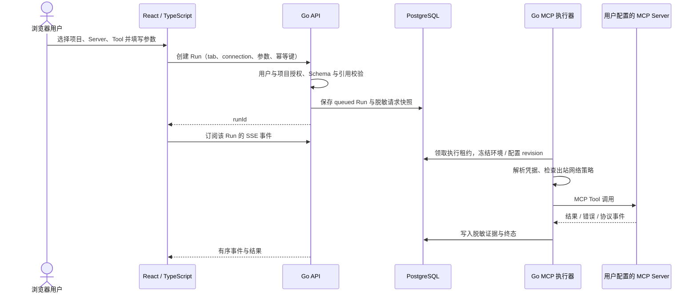

# MCP Inspector 服务版：功能分析与 UI 重设计

日期：2026-10-09；更新：2026-10-10。状态：设计草案，供评审；未修改现有应用或部署服务。

配套交付：[交互预览与截图说明](./README.md)、[可点击 UI](./workbench-preview.html)。预览展示四个业务模块和团队协作入口，使用本地内存中的示例数据。

**执行架构更新（2026-10-10）：** 用户进一步明确调用从用户电脑发出，MCP 授权默认本机保存，可主动保存到服务端，并要求 localhost、远程 HTTP 和 stdio。当前方案以[本地优先执行与配置同步](./2026-10-10-local-first-mcp-architecture.md)为准：浏览器 HTTP 直连 / Go 本地 Agent 执行，Go 平台管理用户、团队、项目和配置。Agent 纳入首版；凭据备份、配置同步和历史上传分开控制。本文下面保留原草案供追溯；其集中执行、服务端凭据默认保存、可信集中审计及 Agent 后续加入的条款已取代。成员移除只能直接撤销平台访问，不能承诺收回用户本机已有凭据与缓存。

**记录功能补充：** 平台还负责自动保存调用历史、参数和响应，用户可命名保存请求或请求响应快照。已保存记录纳入首版，并在调用历史模块和 Tool 工作区内分别查看，详见[平台历史与已保存记录](./2026-10-10-platform-history-and-saved-records.md)。下面原草案中移除保存请求 / 响应及仅可选上传历史的范围不再采用。

2026-10-10 最新 UI 方向：用户提供现有 UI 截图，采用左侧功能导航、Tool Catalog 和上下调试分栏，在此结构内美化，调试与历史使用页面。以[截图参考二次设计](./2026-10-10-reference-ui-redesign.md)及[主预览](./workbench-preview.html)为准；第二轮三方案保留参考，本文的平台架构、身份隔离和迁移约束继续有效。

## 1. 已明确的需求

- 核心业务只保留 Server 配置、环境变量配置、Tools 调试、调用历史。
- 支持浏览器访问、用户体系、团队体系、项目体系和邀请团队成员。
- 同时支持内部部署和外部多租户 SaaS，先交付内部部署。
- 后端重开发为 Go；前端采用 TypeScript + React。
- UI 为浅色、紧凑的开发者工作台。

用户、团队、项目、权限与邀请属于平台基础能力；业务导航仍保持四个入口。本草案建议首版使用企业 OIDC 登录；独立邮箱登录作为后续部署选项。首版支持部署网络可达的 Streamable HTTP MCP Server；本地 Agent 属于后续能力。

## 2. 现有功能分析

实际入口以 `src/client/app/InspectorWorkbench.tsx` 为准，有 11 个一级模块：Servers、Tools、Authoring、AI Tool 测试、Skills、环境变量、测试用例、套件、压力测试、报告、历史。

| 功能域 | 现有能力 | 新版范围 |
| --- | --- | --- |
| Server 配置 | Streamable HTTP；无认证 / Bearer / OAuth；自定义 Header；超时；连接 / 断开；安全导出 | 保留，增加项目归属、个人 / 项目凭据标识、后端网络可达性诊断 |
| 环境变量 | 项目与 Server 作用域；JSON 值；Secret；Profile 继承 / 覆盖 / unset；有效值预览 | 保留，基础编辑优先展示，继承规则进入高级详情 |
| Tools 调试 | Tool 目录 / 搜索；定义快照；Schema Form / Raw JSON；复杂 Schema；隔离 Tab；调用 / 取消；JSON / HTTP / RPC / 时间线 | 保留，整合成一屏调试流程 |
| 调用历史 | 参数 / 结果 / 状态 / 耗时 / 协议事件；分页与筛选；固定；只读查看；回放；比较 | 保留追溯、筛选、固定、清理与载入参数；首版通过新草稿人工重新执行；独立比较与直接回放不进入首版 |
| 保存请求 / 响应 | Tool 下命名保存和恢复 | 移除独立业务模块；通过个人草稿和调用历史复用参数 |
| 脚本工作流 | before / after、辅助 Tool、QuickJS、变量提交、断言 | 移出服务版首版 |
| 测试平台 | 单 Tool / 场景 / 套件 / 压力 / 报告 / AI Tool 测试 | 移出服务版 |
| Authoring / Skills | 外部 MCP Host 接入、生成 Draft、验证、人工评审、Skill 编辑 | 移出服务版 |
| 项目 | 本地 registry + 每项目 SQLite 文件 | 保留身份与数据，扩展为团队下的项目及成员授权 |

说明：README 提到 Server 导入，但 `docs/ENVIRONMENT-PROFILES-2.0.md` 明确完整 Server bundle 导入尚未作为公开操作。新版首版不把完整配置导入描述为已有能力；需要时另定格式与身份重绑定规则。

### 必须保留的行为

1. 同 URL 的两个 Server 仍是两个 connection ID，凭据和 runtime 独立。
2. Tab 草稿隔离；服务版额外按用户隔离，团队成员不共用编辑草稿。
3. Run 关联原始项目、连接、Tool 定义快照、调用人、环境与凭据引用版本。
4. Form / Raw 使用同一份规范化参数；非法 Raw 保留编辑文本，阻止执行。
5. 环境 Profile 只能在相应运行会话断开后切换。变量缺失阻止连接或调用。
6. 历史只读；载入参数建立新 Tab，绑定来源 connection ID，不自动执行，也不把来源结果当成新调用成功。
7. Secret 不进入浏览器存储、默认导出、普通日志或提示。已保存 Secret 通过替换更新，普通读取不返回原值。
8. 去除入口不会删除现有 SQLite 文件、旧记录或已发布 migration。

### 代码依赖与迁移风险

- `src/shared/script-workflow.ts` 包含环境变量 schema；拆除脚本功能前，应将环境契约独立。
- `src/server/runs/run-service.ts` 复用 Authoring 的脱敏函数；重开发时建立通用 redaction 模块。
- `src/client/features/tabs/DebugWorkspace.tsx` 混合调试、脚本、保存项、测试创建和历史；前端需要按调试主流程拆分。
- 现有 `runDetailSchema` 没有专门的 environment / profile 历史快照字段。服务版补充脱敏的环境来源及 revision，旧数据展示“未记录”，不能由当前环境推测历史环境。

## 3. 是否可以服务化

**可以，但需要重建多用户的身份和运行上下文，现状不能直接对公网开放。** React SPA、HTTP API、连接层、Run 和环境模型可以作为需求与行为基线；Go 后端重新实现这些契约。

| 现状 / 源码依据 | 服务化影响 | 新版处理 |
| --- | --- | --- |
| `config/runtime-config.ts` 强制监听 127.0.0.1 | 入口只为本地使用设计 | Go 服务使用部署配置；HTTPS 入口与显式外部 base URL |
| `security/session-auth.ts` 验证一个进程级 token | 无法识别真实用户 | 独立登录会话、user ID、会话过期和撤销 |
| `projects/project-service.ts` 的 list / open 无 actor | 项目存在性不等于访问权限 | 每次请求检查团队及项目成员关系 |
| `tabs/tab-repository.ts` 的 Tab 无 user ID | 多人可能看到同一草稿 | 私人 workspace / tab owner，分享通过显式 Run |
| `connections/oauth-flow.ts` 按 connection ID 缓存凭据 | 共用项目 Server 时个人 OAuth 可能混用 | credential binding + user ID + connection ID 隔离 |
| Run 和连接使用进程内 Map | 多副本和重启无法可靠恢复执行 | 持久化 Run、执行租约、worker 归属和中断恢复 |
| `main.ts` 在服务端 open 浏览器处理 OAuth | 远程用户的浏览器不会自动打开 | 返回授权 URL，由发起用户浏览器跳转；callback 校验 actor / state / PKCE |
| 每项目 SQLite，WAL | 可支撑受控单实例内部版，但不适合作为共享多实例文件存储 | 服务版建议 PostgreSQL；旧 SQLite 以显式迁移工具导入，原文件保留 |
| Server URL 可由用户填写 | 后端出站请求成为用户控制的网络访问 | 按部署模式设置网络策略，对 DNS / 重定向 / OAuth 发现和所有出站请求执行检查 |

这是一项新服务架构设计。PostgreSQL、Go 和平台身份能力在服务版中新增，不对现有应用执行未经评审的数据库替换。

## 4. 技术选择与调用链路

| 层 | 建议 | 原因 |
| --- | --- | --- |
| 后端语言 | Go | HTTP 服务、并发调用、取消 / 超时、部署为单一二进制 |
| HTTP 层 | 标准 `net/http`，按模块组织路由与 middleware | 四个业务域无需复杂服务框架；框架选择不进入业务契约 |
| MCP 客户端 | 官方 `github.com/modelcontextprotocol/go-sdk/mcp` | 提供 MCP Client 与 Streamable HTTP；版本锁定后跑实际 Server 兼容测试 |
| 前端语言 | TypeScript | Server / Tool / Run 类型复杂；需要清晰的客户端状态与输入契约 |
| 前端框架 | React + Vite | 复用现有 primitives、Phosphor、语义 tokens、i18n 与 Schema 编辑经验 |
| API 契约 | OpenAPI 作为单一契约，生成 TS 类型 / client；运行时仍验证响应 | Go 与 TS 无法继续直接共享 Zod 源码；防止两边手工维护漂移 |
| 数据 | 服务版 PostgreSQL | 同时准备团队与 SaaS 的授权关系、Run 持久化及 worker 租约 |
| 实时状态 | SSE + 普通 HTTP 操作 | 前端订阅 Run 事件；取消通过显式 API；重连按序号补事件 |
| 初期部署 | Go 模块化单体 + 前端静态资源 + PostgreSQL | 先内部部署；执行器可同进程启动，后续拆 worker，不先拆微服务 |

Go SDK 的 OAuth 能力与协议兼容随版本变化，正式实现应锁定 SDK / 协议版本，独立验证授权发现、PKCE、回调、刷新与凭据隔离，不能按“SDK 自动保证与旧版一致”估算。调用位置和认证说明更新见 [MCP 执行决策](./2026-10-10-mcp-execution-decision.md)。

### Tool 调用由谁发起

**由 Go 后端的 MCP 执行器发起。前端请求的是 Inspector API，不直接请求用户配置的 MCP Server。**



实际 endpoint 使用 `/api/v1/teams/{teamId}/projects/{projectId}/...`；路由里的 ID 只作为定位数据，授权来源必须是服务器校验的登录身份。

创建 Run 推荐先由数据库唯一约束接收幂等键，避免双击产生两次下游调用。worker 用租约保证执行归属；SSE 断线不取消已经接受的 Run。对于非幂等 Tool，进程崩溃后不能承诺 exactly-once，也不能自动重新发送；标记 interrupted / 执行结果未知，保留已发送证据供人工判断。

直接从浏览器调用会分散凭据、授权、审计、超时和网络可达性管理，还要求每个下游 Server 满足浏览器跨域要求。它不作为团队版默认模式。

### 目标网络可达性

| 用户配置的 Server | 内部部署 | 公网 SaaS |
| --- | --- | --- |
| 公网 HTTPS endpoint | 部署网络允许时可调用 | 出站策略允许时可调用 |
| 公司内网 endpoint | 应用部署在该网络且域名 / 网段获管理员批准时可调用 | 需要企业连接器 / Agent / 专用网络接入 |
| 用户电脑 `localhost` | 远程部署无法直接访问；同机自托管除外 | 需要用户电脑上的本地 Agent |
| 本地 stdio 程序 | 当前项目未支持；后续经 Agent 转接 | 后续经 Agent 转接，不在共享服务器执行任意用户命令 |

“浏览器无需安装即可调试”首版成立的前提：Server endpoint 对服务部署节点可达。平台既不扫描用户本地配置文件，也不自动读取本机环境变量；用户手工填写并保存项目 Server 与环境配置。

## 5. 用户、团队、项目与权限

```text
用户 User
  └── 团队成员 TeamMembership（一个用户可加入多个团队）
       └── 团队 Team
            ├── 邀请 Invitation
            └── 项目 Project
                 ├── 项目授权 ProjectMembership
                 ├── Servers / CredentialBindings
                 ├── 环境变量 / Profiles
                 ├── 用户私人 Workspace / Tabs
                 └── Runs / Events（记录调用人）
```

建议创建用户后拥有私人团队；内部版默认仅接受企业身份或管理员邀请，关闭公开注册。SaaS 可开启注册；两种部署使用同一模型。项目归属于一个团队，转移项目需要单独迁移策略，不作为普通编辑。

### 权限建议

团队角色：Owner 管理团队与所有权；Admin 管理成员和项目授权；Member 使用获授权项目。邀请成员加入团队不自动赋予所有项目权限。

项目角色：

| 能力 | Maintainer | Developer | Viewer |
| --- | --- | --- | --- |
| 查看 Server 元数据、非 Secret 环境值 | 是 | 是 | 是 |
| 查看项目脱敏调用历史 | 是 | 是 | 是 |
| 执行获准 Tool、取消本人 Run | 是 | 是 | 否 |
| 配置 Server、环境和共享凭据 | 是 | 否 | 否 |
| 管理项目成员、清理历史 | 是 | 否 | 否 |
| 使用项目凭据 | 经 use-credential 权限 | 经 use-credential 权限 | 否 |
| 查看 Secret 明文 | 默认不开放 | 默认不开放 | 否 |

团队管理权与执行 / 使用凭据权分开授权。持有 run 权限不会自动获得所有共享凭据的使用权。项目历史原始业务内容也可能敏感，所有可见结果都受成员授权与脱敏策略约束。

### 共享与个人边界

- 项目共享：Server endpoint、Tool 快照、非个人环境配置、项目级服务账号凭据、获授权的历史。
- 用户私有：Tab、参数草稿、个人 OAuth、个人凭据、编辑布局。
- 个人凭据不能被其他成员“载入历史”后自动复用。重新执行使用操作者当前获准的凭据，并明确显示凭据身份不同。
- 项目级变量被用于共享调用；个人凭据不应混在同名项目变量里。使用 credential binding 单独保存。
- runtime key 至少覆盖 `teamId / projectId / connectionId / userId / credentialBindingId / profileId / configRevision / authRevision`，connection ID 仍是必需身份。
- 一人的断开、取消或环境切换只影响本人的相应 runtime；编辑共享配置会增加 revision，并要求受影响 runtime 显式重连。
- Run 的 actor、环境来源、配置与凭据 revision 保存为历史事实，凭据只存引用和安全元数据。

### 邀请流程

1. 有 invite 权限的成员填写邮箱、团队角色、初始项目与项目角色。
2. 后端创建一次性随机 token，仅保存 token hash；建议有效期 7 天，可撤销。
3. 内部版可以复制邀请链接；接入邮件服务后由系统发送，事务提交后使用 outbox 重试。
4. 被邀请人登录并验证目标邮箱，再接受邀请；已有账号直接加入，没有账号完成首次身份建立。
5. 同一事务检查过期、撤销、接受人、邀请方当前权限、团队容量和角色合法性，然后创建 membership 并标记 accepted。
6. 过期、撤销、邮箱不匹配提供明确页面；重复接受幂等，不生成重复成员。移除成员后立即撤销项目访问、事件订阅、待执行任务和相应凭据会话。

邀请 token 是凭证。可使用 URL fragment 引导浏览器读取后立即清理地址，随后用 POST 提交，避免进入服务端访问日志；邀请页不加载第三方资源，禁止记录 token。

## 6. 数据、API 与服务边界

建议核心实体：`users`、`login_sessions`、`teams`、`team_memberships`、`invitations`、`projects`、`project_memberships`、`connections`、`credential_bindings`、`environment_profiles`、`environment_variables`、`tool_snapshots`、`workspaces`、`debug_tabs`、`runs`、`run_events`、`audit_events`。

所有项目实体含 team / project 归属；跨实体外键包含相应作用域约束，禁止将另一个项目的 connection / profile / snapshot 填入当前 Run。Secret 密文与普通数据分离，部署密钥不存入同一数据库；导出排除密文和明文。

Go 单体内部模块：Identity、Teams、Projects、Connections、Environment、Tools、Runs、MCPExecutor、Audit。模块接口传递已验证的 Principal / ProjectContext，不能只接收无身份的 project ID。

建议 API 分组（待 OpenAPI 评审）：

- `/auth/*`：登录、OIDC callback、会话查询、登出。
- `/api/v1/teams/*`：团队、成员、邀请；`/invitations/accept` 处理安全接受请求。
- `/api/v1/teams/{teamId}/projects/*`：项目与项目成员授权。
- 项目下 `/servers`、`/environment`、`/profiles`、`/tools`、`/workspaces`、`/runs`。
- `/runs/{runId}/events`：授权后订阅；支持事件 sequence 补取。
- `/runs/{runId}/cancel`：校验本人 / 管理权限后取消，保留终态与原因。

服务版先用单实例 / 同进程执行器，但 Run 领取与归属从首版持久化。后续拆 worker 时保持同一契约；连接会话归属由 executor ID 与租约识别。无状态 API 副本不得假定任意 MCP runtime 都在本机。

## 7. UI 重设计

### 方案选择

推荐 **固定上下文的四入口工作台**：适合重复调试，参数与结果同屏，团队 / 项目管理进入上下文入口。

备选一为配置向导：新用户易上手，但重复调试需要更多跳转；用在首次创建 Server，不作为全局布局。备选二为所有功能放在一个超长页面：上下文直观，但滚动、状态和历史拥挤，不适合作为日常工作台。

### 全局 Shell

- 顶部 56px：品牌、团队 / 项目切换、四个模块入口、成员管理和账户。
- 第二行 44px：Server selector、授权身份、有效环境、真实运行会话状态。
- 底部状态栏：网络与执行状态、当前项目，原型额外显示“设计预览 · 示例数据”。
- 首次使用进入 Server 配置；已有上下文默认恢复个人 Tools 工作区。
- 配置页不重复额外 Server Tab；Tool Tab 是私人的工作文档。团队 / 项目切换明确刷新授权域。

### A. Tools 调试

```text
Tool 目录 232px │ 私人 Tool 文档
               │ Tool 标题、说明、执行按钮
               ├──────────────────┬──────────────────
搜索、工具名称 │ 请求参数          │ 调用结果
当前选择       │ Form / JSON       │ 状态、耗时、Run
刷新目录       │ Schema 错误       │ 结果 / 调用详情
               │ 必填与类型信息    │ JSON / HTTP / RPC
```

- 请求 / 结果有分隔条，指针与键盘都能调节；默认接近均衡。
- Tool 定义进入标题旁的详情入口，Schema 在参数字段就地体现。
- 本 Tool 历史是快捷筛选入口，复用全局历史页面，不建立第二份历史状态。
- 执行按钮始终可见；运行时替换为取消。使用 Cmd / Ctrl + Enter 执行，阻止双击。
- 结果保持结构化内容；“调用详情”折叠展示 HTTP、RPC、时间线、快照、环境来源与 actor。

### B. Server 配置

- 左侧 Server 列表：名称、endpoint、当前用户会话状态；同 URL 也分别展示。
- 右侧常驻编辑区：基础信息、认证、Header、超时、环境、凭据归属与有效引用检查。
- 已有 Secret 输入留空表示保持不变；明确替换才更新。
- 保存与连接分开；保存不会隐式执行 Tool。连接成功后有“打开 Tools”入口。
- “个人 OAuth / 项目凭据”明确显示，避免把别人的在线状态显示成本人的连接。
- URL 格式合法与部署网络可达是两项不同检查，失败显示明确原因与下一步。

### C. 环境变量

- 左侧 Profiles；右侧变量表，切换“项目变量 / Server 变量 / 生效预览”。
- 列包含 name、类型、值 / Secret、作用域、来源与覆盖关系。
- 编辑器使用侧面板或原生 Dialog，不在页首堆叠一长排输入控件。
- 当前生效环境显示在全局上下文；浏览另一个 Profile 不代表已经切换运行会话。
- Profile 继承保留但收进高级信息；有效值预览不返回 Secret。

### D. 调用历史

- 列表 / 详情双栏：搜索、Server / Tool / 状态 / 调用人 / 时间筛选；游标分页。
- 每条显示状态、Tool、Server、调用人、环境、耗时和时间；选中项详情只读。
- “载入参数”恢复到新个人 Tab，绑定来源 Server；结果区显示未执行与来源 Run。
- 旧来源 Server 已删除、Tool 已移除或 Schema 改变时明确提示，不能偷偷切到同 URL Server。
- 固定和清理从列表操作；清理确认显示范围，并保留受引用的重要历史。

### E. 团队、项目、账户和邀请

保持业务导航四项。点击顶部团队 / 项目进入项目管理；点击成员入口进入成员表与邀请表。邀请选择邮箱、角色、初始项目，展示待接受 / 过期 / 已撤销状态。

需要独立页面：登录、创建 / 选择团队、项目列表 / 创建、成员与权限、邀请接受。登录页根据部署配置显示企业登录与启用的邮箱方式，不展示未实现的登录入口。

### 视觉与交互标准

- 继续使用 `src/client/app/redesign.css` 的语义颜色与系统字体；浅色 warm-neutral 背景、小面积 accent、6px 控件圆角，列表 / 分栏不堆叠卡片。
- 图标用现有 Phosphor；产品实现复用现有 primitives 和 i18n。
- UI 14px，辅助信息至少 11px；Tool / JSON / 路径用 mono。
- 宽度 ≥1024px 完整工作台；760–1023px 缩窄目录；更窄时上下排列，核心操作可达。
- `100dvh` shell，分栏独立滚动，标题 / 执行 / 结果状态固定；没有 body 与面板双重纵向滚动。
- 定义 empty / loading / ready / error / stale；状态来自服务事实，不能用 UI timeout 伪造。
- 双语与深色能力仍属于正式产品验收；本次原型是中文浅色设计演示，使用纯示例数据，无真实用户系统和 MCP 调用。

## 8. 内部版与 SaaS 的差异

| 项目 | 内部部署首版 | SaaS 后续 |
| --- | --- | --- |
| 登录 | 企业 OIDC、邀请制 | 企业 OIDC + 可配置邮箱注册 / 登录 |
| 团队 / 项目 / 权限 | 从首版具备 | 同一模型 |
| 网络 | 管理员批准的内部 endpoint / 网段 | 默认允许获准公网目标，阻断内部 / 元数据；Agent 提供客户内网接入 |
| 存储 | PostgreSQL + 部署卷 / 对象存储按响应规模选择 | 同一 schema，增加容量配额与隔离策略 |
| 执行 | 单实例，可同进程 worker，持久化任务与租约 | 独立 worker、并发配额、队列与执行隔离 |
| 运维 | HTTPS、备份、健康检查、重启恢复、审计 | 额外租户配额、用量、集中监控与生命周期管理 |

## 9. 建议交付顺序与验证

1. **设计与契约确认**：四模块 UI、权限、共享凭据、网络接入与 OpenAPI。
2. **Go 平台基础**：用户登录、团队、项目、邀请、授权中间件、PostgreSQL；禁止无权限获取项目详情。
3. **连接与环境**：Streamable HTTP、Bearer / Header、环境引用、个人 OAuth、配置 revision 与网络策略。
4. **调试与历史闭环**：目录、Form / Raw、个人 Tab、持久化 Run、SSE、取消、历史与载入参数。
5. **旧数据显式迁移与内部交付**：保留原 SQLite，验证数量、身份、Secret、快照与记录；部署和回滚文档。
6. **SaaS 与 Agent**：公网租户运营能力、worker 扩展、内网 / 本机接入。按需要追加，不阻塞内部版。

必要回归测试：跨团队 / 项目越权；同 URL 不串凭据；同 Server 两用户 OAuth 不串；同 Tool 草稿隔离；过期 / 重放 / 撤销邀请；移除成员后的 SSE / 执行拒绝；Form / Raw 一致；缺变量；重复执行幂等；SSE 断线恢复；进程中断无静默重试；历史来源身份；Secret 不泄露；DNS / IPv6 / 重定向 / OAuth discovery 网络策略；两个语言与键盘核心旅程。

Go 正式实现运行 `go test ./...` 与 race 检查；前端按仓库要求运行 typecheck、test、build。涉及核心工作流、认证、持久化和布局时仍需完整验证门禁；跨语言新项目需建立等价的统一 verify 命令。本次仅设计原型和文档，验证范围为原型交互、布局和浏览器错误，不代表后端功能已开发。

## 10. 外部资料（2026-10-09 核对）

- [官方 Go SDK](https://github.com/modelcontextprotocol/go-sdk)：客户端 / 服务端 SDK；README 标注客户端 OAuth experimental。
- [MCP transport 概览](https://modelcontextprotocol.io/specification/2026-07-28/basic/transports)：Streamable HTTP 与 stdio、协议版本兼容。实施时锁定 SDK 并验证目标 Server 支持的协议，不能由 UI 设计推断兼容性。
- [OWASP SSRF 防护](https://cheatsheetseries.owasp.org/cheatsheets/Server_Side_Request_Forgery_Prevention_Cheat_Sheet.html)：目标校验、DNS、重定向与网络层限制。
- [OWASP Authorization](https://cheatsheetseries.owasp.org/cheatsheets/Authorization_Cheat_Sheet.html)：默认拒绝与每请求授权。
