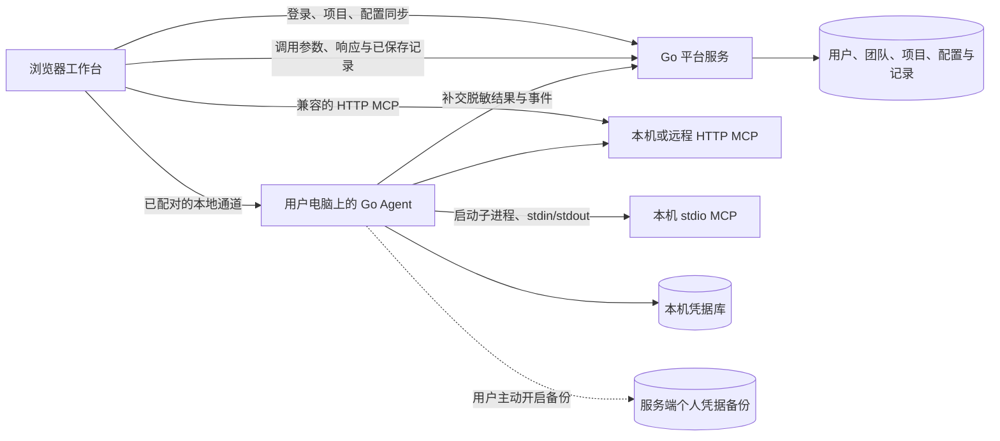

# MCP 服务版：本地优先执行与配置同步

日期：2026-10-10。状态：依据用户补充需求更新的架构方案，尚未实现。取代[此前集中后端执行的决定](./2026-10-10-mcp-execution-decision.md)。

进一步补充：平台负责保存调用历史、请求参数、响应和已保存记录。下文已调整为正常调用自动记录到平台；详细 UI 与契约见[平台历史与已保存记录](./2026-10-10-platform-history-and-saved-records.md)。个人凭据备份仍单独选择，不影响历史记录。

## 决定与原因

用户希望平台保存每个用户在项目中的配置，MCP 授权默认留在本机，可以主动保存到服务端，并能调试本机 localhost、远程 HTTP 和本机 stdio MCP。

新版采用 TypeScript + React 浏览器工作台、Go 平台服务和 Go 本地 Agent。前端发起和管理调试；HTTP 可由浏览器直接执行，stdio 与需要本地持久凭据或跨域兼容的 HTTP 由用户电脑上的 Agent 执行。Go 平台承担用户、团队、项目、权限、配置同步及参数 / 响应记录，实际 MCP 请求从用户电脑发出。本地 Agent 从首版交付，不能再推迟到 SaaS 阶段。

“调用从用户电脑发出”与“所有协议都由网页直接执行”是两个不同要求。普通网页不能启动任意本机进程；MCP stdio 要求客户端启动子进程并读写 stdin/stdout，因此必须增加本地运行组件。这里的 Agent 是用户电脑上的程序，与远程平台后端分开部署。

## 执行能力与选择

| 目标 | 浏览器直连 | 本地 Agent | 首版安排 |
| --- | --- | --- | --- |
| 远程 Streamable HTTP MCP | 支持，但目标必须满足 CORS、Origin、TLS 和授权交互要求 | 用户电脑网络可达即可，不受浏览器对下游的 CORS 限制 | 支持两种入口；持久本地授权优先走 Agent |
| 用户电脑上的 localhost HTTP MCP | 条件支持；需目标支持跨域，浏览器可能要求本地网络访问权限 | 支持，localhost 指 Agent 所在电脑 | 纳入首版 |
| 本机 stdio MCP | 普通网页不支持启动本机进程 | 启动用户确认过的本地配置，管理进程与协议会话 | 纳入首版，要求安装 Agent 和对应 MCP 运行依赖 |
| 只有平台服务器能访问的 MCP | 用户电脑网络不可达时不支持 | 用户电脑网络不可达时不支持 | 可另行加入受控服务端执行；不自动切换 |

Server 配置中明确选择“浏览器直连”或“本地 Agent”。首次配置可根据传输和 Agent 在线状态推荐方式，但在执行前必须显示实际执行位置。不在请求已经发出后静默切换通道重试，避免有副作用的 Tool 被调用两次。

未安装 Agent 时仍可调试兼容的 HTTP MCP；stdio 和需要本地凭据库的连接显示具体安装 / 配对入口。不得宣称浏览器本身可以运行 stdio。远程平台的 localhost 指平台服务器，不能用来定位用户电脑。

网页连接 Agent 本身仍须满足浏览器策略。使用 HTTPS 工作台，检测浏览器本地网络许可；通过真实浏览器验证部署域名、loopback 地址和证书组合。不能以禁用浏览器安全检查作为正式使用方式。Agent 的下游请求不受浏览器 CORS 限制，不代表网页到 Agent 的连接没有跨域或权限要求。

## 配置、凭据和历史分别管理

| 数据 | 默认位置 | 可选同步与共享 |
| --- | --- | --- |
| 用户、团队、成员、项目和邀请 | 平台数据库 | 按项目成员权限访问 |
| 项目 Server 模板、非 Secret 环境值、配置 revision | 平台数据库 | 项目共享；不包含授权 Token 或本机秘密 |
| 用户对该 Server 的环境选择、非敏感配置覆盖 | 平台，按 user + project + connection 隔离 | 本人跨设备读取，不覆盖团队模板 |
| 本机命令路径、工作目录、文件引用及机器相关覆盖 | 本地 Agent | 可显式同步可移植模板；实际路径和文件不默认上传 |
| 个人 OAuth、API Key、Secret 环境值、Agent 配对秘密 | 本机 Agent 凭据库 | 用户对每个绑定主动选择保存到服务端；默认不上传 |
| 浏览器直连使用的临时授权 | 当前浏览器会话内存 | 不写 localStorage / IndexedDB；需要持久保存时使用 Agent 凭据库 |
| 调试参数、结果、协议记录 | 平台保存脱敏快照；本地执行组件保留当前执行数据与待上传记录 | 正常调用自动记录，按项目权限查看；上传不包含 MCP 认证秘密 |
| 用户主动保存的请求 / 请求响应记录 | 平台，默认仅本人 | 可明确共享给项目成员，独立于历史清理 |

项目配置属于共享模板，用户配置覆盖属于私人设置。同一个项目 Server 的两位用户可以选择不同环境和各自的授权。Secret 引用的元数据可以同步，Secret 值不混入普通配置、草稿、导出、URL、日志或 Toast。

凭据的“归属”“存储位置”和“执行位置”是三个独立属性：个人凭据可以备份到服务端但仍由 Agent 使用；项目共享凭据需要另行授予使用权。保存个人凭据到服务端不等于让团队成员使用。

## 本地授权与可选服务端保存

本地 Agent 负责安全持久化，使用系统凭据库，或使用密钥受到保护的加密本地存储。浏览器仅短暂处理手工输入或 OAuth 交互，保存后普通读取只返回状态、有效期和引用，不返回秘密明文。

个人凭据保存到服务端时，以独立、明确的操作开启：显示保存范围“仅本人”、绑定的项目 / connection，以及将上传什么。优先采用本地加密的个人备份，由受信任的 Agent 经专用恢复流程恢复到本机凭据库；密钥持有人、新设备配对和恢复方式必须在实现前定义并验证。平台账号登录本身不能直接解密备份。首版不承诺无密钥恢复，也不通过普通浏览器配置 API 下发已保存的秘密。

OAuth 备份不保证能在另一台电脑继续使用；是否允许跨设备恢复、刷新 Token 是否轮换或绑定设备取决于授权服务。授权失效时重新授权，不让多个设备无协调地使用同一个会轮换的刷新 Token。恢复本地环境时也不能假定另一台机器具备相同命令和依赖。

如果将来增加“不向成员电脑分发共享凭据，但允许成员调用”的团队模式，需要平台或受控执行节点代为调用。把共享秘密分发到成员设备后，平台无法保证成员不能读取或复制它，也无法通过移除项目成员收回已经复制的秘密。团队邀请用于管理平台项目访问，不承诺替代下游 MCP 的授权。

工作台登录与 MCP OAuth 继续分开。授权绑定至少包含 userId、projectId、connectionId；会话还包括执行节点 / deviceId、环境和配置、认证版本。同 URL 的不同连接不合并授权。OAuth 使用资源对应的 Token，校验 state / PKCE / 回调归属，回调地址必须符合下游授权服务的注册与协议要求。

## 本地调用生命周期与历史

1. 前端从项目模板和本人覆盖合成有效配置；Agent 再解析本地 Secret 与文件引用。缺失项阻止调用。
2. 当前执行组件完成 MCP 初始化、能力协商和工具发现；Tool 调用使用 SDK 会话，不简化成一次任意 JSON POST。
3. 执行前冻结 project、connection、user、device / executor、Tab、Tool 定义、参数、环境和认证 revision；在线模式由平台接受脱敏请求并创建独立 runId，再由本地组件执行。
4. 浏览器直连的运行依赖页面生命周期；刷新或关闭后无法保证仍可追踪执行。Agent 运行独立于页面，可通过 runId 恢复状态与已持久化事件。
5. 超时、取消和断线不承诺回滚已发生的副作用。结果不明时标记未知，不自动重发非幂等调用。
6. 当前工具历史与已保存记录精确按项目 + connection + tool 筛选；总集合另行聚合。展示执行位置、执行人和“已记录 / 等待上传 / 上传失败”状态。
7. 按 runId 自动幂等补交脱敏响应和事件。服务端验证上传者身份和项目权限，actor 来自登录身份；限制载荷大小与敏感字段。重试上传不重试 MCP 调用。

浏览器和个人 Agent 上传的历史是客户端报告的执行记录，不应伪装成平台独立观察到的审计证据。记录来源和平台接收时间；若将来需要可信的集中审计，使用受控执行节点并单独设计证明与权限。平台离线时默认不创建新的在线项目调用；后续显式离线模式由 Agent 保留待上传记录。响应上报失败不能伪装成调用失败；无权限时不能补交进项目。

## Agent 边界与标准组件

Agent 只监听 loopback，校验 Origin 和 Host，与指定工作台进行显式配对。配对身份按平台、用户和设备隔离，敏感令牌不放 URL，不持久化到浏览器存储。执行凭据按绑定的 connection 和获准目标使用，不提供“任意目标 + 任意 Secret 引用”的通用代理。

从平台同步的 stdio 命令只是配置，不能收到配置后自动运行。首次运行及命令、参数、工作目录变更需要本机确认，使用结构化进程参数，不拼接 shell 命令；进程继承的环境和可访问文件明确受限。移除成员立即撤销平台访问，但本机缓存、已启动任务和下游授权的撤销需要分别处理。

沿用既有工作台布局，正式开发建议增加以下标准组件，复用现有 tokens、Phosphor、i18n 和字段控件：

- `ExecutionLocationField`：浏览器直连 / 本地 Agent；展示 Agent 配对与在线状态、可达性诊断。
- `CredentialStorageField`：默认“仅本机”；明确的个人服务端备份操作与状态，不与执行位置绑定。
- `ConfigurationScopeField`：项目模板 / 我的覆盖 / 本机覆盖，显示有效值来源；Secret 仅显示引用。
- `PlatformRecordStatus`：已记录 / 等待上传 / 上传失败；保留独立的工具内历史和已保存集合及详情页。

顶部认证标识继续解释 MCP 凭据来源，不承担用户登录或执行位置选择。当前原型已加入历史与已保存记录的页面交互，仍是示例数据，没有真实 Agent、凭据库或平台持久化链路。

## 交付顺序与验证

先建立平台与 Agent 的共同契约，再交付浏览器 HTTP、Agent HTTP / stdio 和本地授权保存的调试闭环，同时完成 Go 平台用户、团队、项目、邀请、非敏感配置同步、自动历史记录及已保存快照。个人凭据备份作为独立显式能力验证；集中执行作为后续部署选项。

正式实现必须验证：同 URL 不串凭据、跨用户 / 项目 / 设备隔离、浏览器 CORS 与本地网络许可、Agent 配对与 Origin / Host 校验、stdio 本机确认与进程退出、Token 不进入浏览器持久存储和普通日志、OAuth 刷新 / 恢复、多设备配置冲突、取消和断线后未知结果、历史来源和幂等上传。保留现有 SQLite 文件与已发布 migrations。

## 参考依据

以下资料于 2026-10-10 查阅；传输文档固定到 2025-11-25 用于说明边界，正式实现另行锁定 SDK 与目标协议版本。

- [MCP Transports](https://modelcontextprotocol.io/specification/2025-11-25/basic/transports)：stdio 子进程、Streamable HTTP、Origin 校验和本地绑定。
- [MCP Authorization](https://modelcontextprotocol.io/specification/2025-11-25/basic/authorization)：OAuth、资源绑定、PKCE 和凭据保护。
- [MDN CORS](https://developer.mozilla.org/en-US/docs/Web/HTTP/Guides/CORS)：浏览器跨域访问条件。
- [Chrome Local Network Access](https://developer.chrome.com/blog/local-network-access)：网页访问本地网络 / loopback 的许可与安全上下文要求。
- [MCP Go SDK](https://github.com/modelcontextprotocol/go-sdk)：Go Client 和传输；正式开发锁定版本并验证 HTTP、stdio 与授权兼容。
