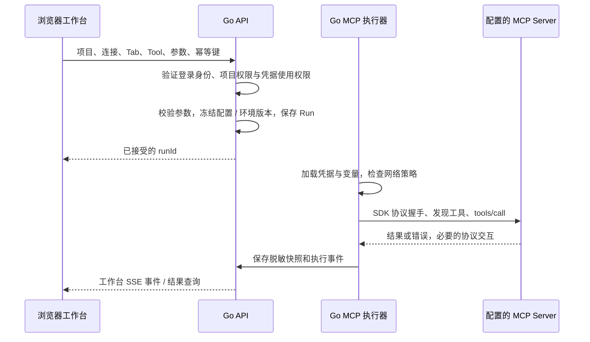

# MCP Tool 调用位置与认证说明

日期：2026-10-10。状态：已被[本地优先执行与配置同步方案](./2026-10-10-local-first-mcp-architecture.md)取代，本文保留此前集中执行方案的分析和文案调整记录。尚未实现 Go 服务，预览中的调用仍为模拟。

用户补充 localhost、stdio 和授权默认留在本机的需求后，新版改为浏览器发起、浏览器 HTTP 直连 / Go 本地 Agent 执行，平台管理用户、团队、项目与配置同步。Agent 纳入首版，服务端凭据保存由用户显式开启。下文“默认后端执行”和“Agent 后续加入”属于此前方案，不作为当前开发要求。

## 决定

新版采用浏览器 → Go API → Go MCP 执行器 → MCP Server。浏览器提交调试参数、选择项目 / 连接 / 工具并展示状态；真正的 MCP Client 运行在后端。首版 API 与执行器可以同进程部署，后续按并发与网络需求拆出 worker，不要求先引入微服务。

这是基于用户体系、项目体系、团队邀请和共享调试的产品选择，不是 MCP 协议规定浏览器不能作为客户端。

## 当前项目的依据

当前 TypeScript 后端在 `src/server/runs/run-service.ts` 内按 connection ID 调用 `runtime.callTool`，由 `src/server/connections/streamable-session.ts` 将请求转换为 MCP `tools/call`，使用当前连接的认证、超时与取消信号。新版迁移到 Go 时保留这个边界，再增加租户、用户和凭据归属隔离。

当前实现仍是本地 Inspector，不具备本草案所述的完整团队服务端授权与执行架构。浏览器设计原型没有接入这条真实调用链。

## 前后端方案比较

| 维度 | 浏览器直接调用 MCP | Go 后端调用 MCP |
| --- | --- | --- |
| 项目凭据 | 调用必须在浏览器获得可用凭据，共享秘密分发和回收复杂 | 已保存秘密保留在服务器；前端显示来源和引用，不返回明文 |
| 个人授权 | 可以按个人授权调用，但登录工作台与下游授权仍需分开 | 浏览器完成授权交互，后端保存该用户、该连接的下游凭据 |
| 权限与审计 | 下游能授权，但工作台需额外可信机制维护团队权限与真实调用历史 | 接受请求前验证团队 / 项目 / Tool / use-credential 权限，记录真实调用人 |
| 网络与跨域 | 要求浏览器网络可达，跨域 MCP endpoint 还要支持相应 CORS / Origin 策略 | 要求部署节点网络可达，浏览器只访问工作台 API；仍有 TLS、出站策略与认证要求 |
| 生命周期 | 页面关闭、刷新和网络中断使客户端状态与执行记录管理更复杂 | Run 单独持久化，前端订阅；断线后重新读取状态与记录 |
| 传输 | 可实现 HTTP 传输，普通网页不能启动任意本地 stdio 子进程 | Go SDK 支持 HTTP 与 stdio；共享服务上的进程执行必须受管理员策略与隔离约束 |
| 成本 | 少一跳服务端转发，适合单人、临时、无共享秘密的工具 | 增加一跳与执行资源，但可集中管理并发、连接、超时和团队历史 |

浏览器直连可以作为特定个人产品的执行方式；本项目的团队模式默认全部经后端执行，避免同时维护两套凭据和审计路径。

## 职责与一次调用

连接建立时完成初始化与能力协商，工具目录通过 SDK 的发现接口维护；不是每次调用都重复初始化。后端必须处理协议版本、分页、定义变化、超时和授权过期；不能把 `tools/call` 简化成未经验证的 JSON HTTP 透传。

前端提交 connection ID，由后端读取该连接的受控 endpoint 与凭据绑定。不能允许执行接口凭借前端给出的任意 URL 或 Token 绕过项目配置和权限。运行身份至少隔离团队、项目、连接、用户 / 凭据绑定、配置与认证版本；同 URL 不合并认证。

接受的 Run 使用独立执行生命周期，不能直接绑定已结束的浏览器 HTTP 请求。关闭页面或 SSE 断线不自动等于取消；取消通过显式 API，由执行器尽力传播给下游。取消和超时不能承诺回滚已经产生的副作用。修改商品、删除数据等调用在响应丢失后不能盲目重发；记录执行结果未知，幂等键防止工作台重复创建，不承诺跨进程 exactly-once。

## 网络可达性与本地服务

| 目标 | 首版处理 |
| --- | --- |
| 公司内部 MCP | 工作台部署在可访问的公司网络，由管理员批准相应域名 / 网段 |
| 获准的公网 MCP | Go 执行器通过受控出站网络访问 |
| 用户电脑 `localhost` | 远程服务无法直接访问；同机部署除外。后续增加本地 Agent |
| 用户电脑上的 stdio 程序 | 后续经本地 Agent 执行并回传；不在共享服务上启动任意用户命令 |

本地 Agent 的控制与结果仍经工作台后端授权和记录，凭据可根据部署策略保留在本机。它不是让浏览器直接承担 MCP 执行。

后端访问用户配置目标和 OAuth 发现 / token / 重定向地址，需要 SSRF 防护：校验目标、DNS 实际解析和每次重定向，并限制出站网络。内部部署允许管理员批准的内网 MCP，SaaS 默认不能任意访问内网、loopback 或云元数据；需要内网接入时走受控连接器 / Agent。

## 两种账号与凭据

工作台登录身份用于确定“哪个用户、属于哪个团队、能访问哪些项目”。MCP 认证用于确定“用什么凭据访问这个 MCP Server”。两者分开；不能把工作台登录 Token 原样当成下游 MCP Token。下游 OAuth 使用为该资源签发的令牌，按用户和 connection ID 绑定保存。

项目共享凭据供被授予使用权限的成员调用，个人授权仅对应本人。即使下游只看到一个共享服务身份，工作台历史仍记录实际提交调用的用户。使用权限不等于查看秘密明文的权限；Secret 保存后不通过普通 API、日志、导出或浏览器存储返回。

初次手工输入凭据会经过浏览器提交到后端，这是设置过程；不意味着已保存凭据应在每次调试时回传浏览器。正式实现需要 TLS、加密存储、凭据版本和撤销机制。

## 本次预览的文案调整

- 顶部“项目服务账号”改为“认证：项目凭据”；个人连接显示“认证：我的授权”，无认证连接显示“认证：无需凭据”。英文分别显示当前来源，不并排显示双语。
- 点击标识打开该活动连接的服务配置页面，并定位认证区域；显示认证方式、凭据来源和与登录账号的区别。窄窗口隐藏顶部辅助信息时，仍可从服务配置查看。
- 页面已在同一连接的服务配置时，只定位认证区域，不重建表单或丢弃未保存输入。工具草稿在返回工具页后保留。

## 依据

以下资料在 2026-10-10 查阅。协议链接固定到 2025-11-25 版，用于说明传输和授权边界；正式开发需要锁定具体 Go SDK 与目标协议版本并运行实际 Server 的兼容测试。

- [MCP Transport](https://modelcontextprotocol.io/specification/2025-11-25/basic/transports)：stdio 的子进程模型、Streamable HTTP 与 Origin 校验。
- [MCP Authorization](https://modelcontextprotocol.io/specification/2025-11-25/basic/authorization)：HTTP 授权、资源绑定和 OAuth。
- [MCP Security Best Practices](https://modelcontextprotocol.io/docs/2025-11-25/tutorials/security/security_best_practices)：Token audience、服务器部署的 MCP Client 与 SSRF 防护。
- [MCP Go SDK](https://github.com/modelcontextprotocol/go-sdk)：Client、传输和版本兼容；[调用接口](https://github.com/modelcontextprotocol/go-sdk/blob/main/docs/server.md)。
- [MDN CORS](https://developer.mozilla.org/en-US/docs/Web/HTTP/Guides/CORS)：浏览器跨域请求的限制与服务端响应要求。
- [OWASP SSRF](https://cheatsheetseries.owasp.org/cheatsheets/Server_Side_Request_Forgery_Prevention_Cheat_Sheet.html)：目标 allowlist、DNS、重定向与网络防护。
