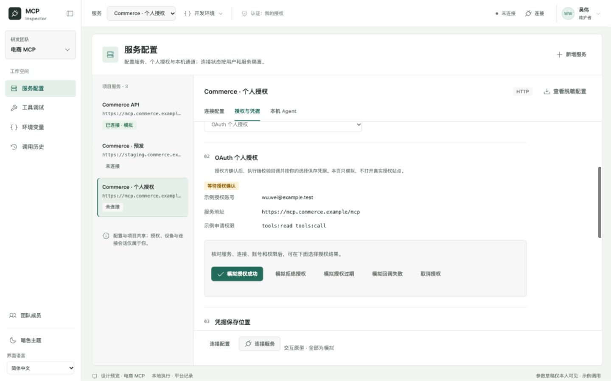
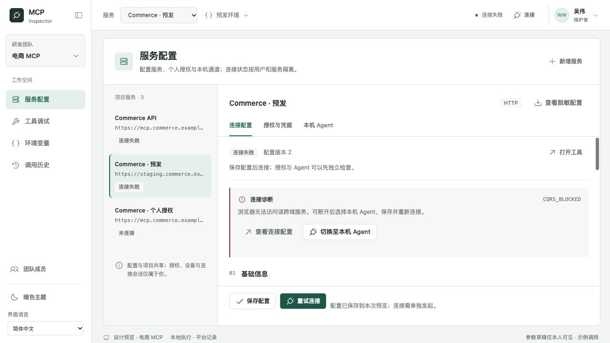
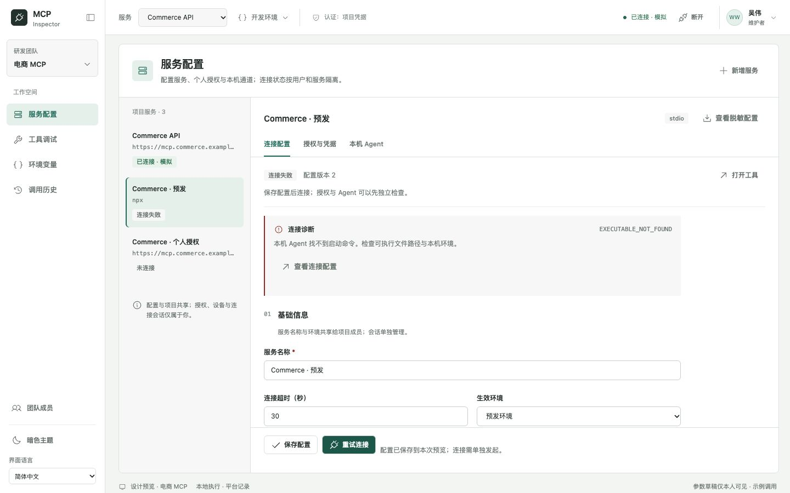
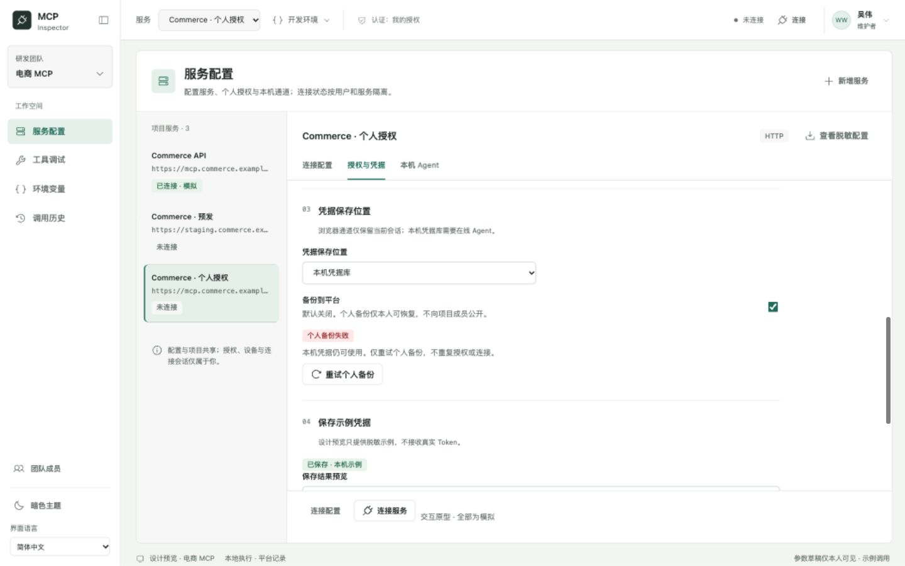
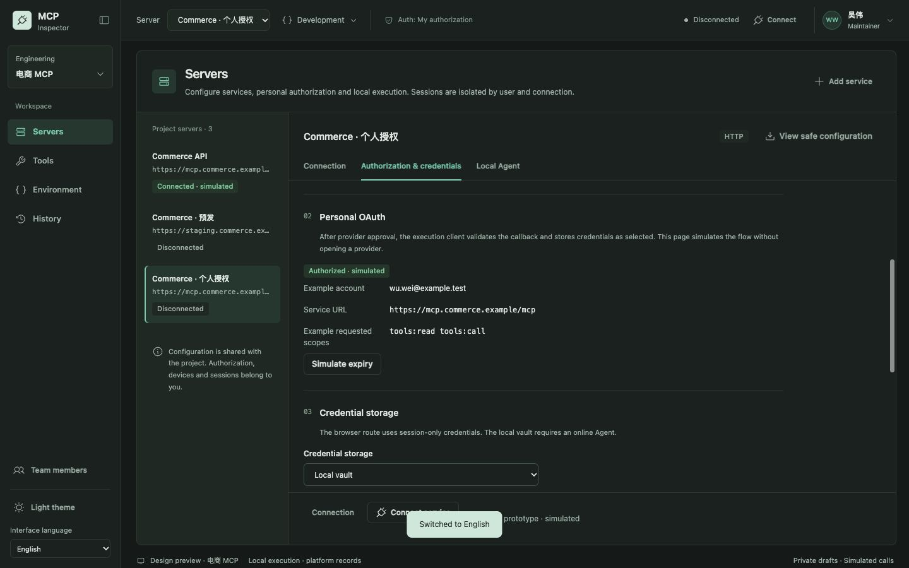

# 服务配置与授权：完整交互原型

日期：2026-10-12。状态：设计评审稿；尚未进入正式开发。

本轮沿用现有浅色 / 深色工作台、服务列表与详情布局，只完善 `docs/redesign/`。没有实现 MCP 请求、OAuth 跳转、本机 Agent、进程启动、真实凭据保存或平台上传。所有业务状态保存在内存，刷新重置；仅语言与主题偏好沿用原型已有的持久化。

## 页面组织

右侧固定服务标题、协议标签与三组页签，下方内容独立滚动，底部保留操作区。顶部服务上下文对应当前正在配置的服务；进入工具调试后对应当前 Tool Tab 的服务。切换配置页签不改变工具草稿的连接身份。

| 页签 | 内容 | 核心操作 |
| --- | --- | --- |
| 连接配置 | 名称、环境、超时、HTTP / stdio、浏览器 / Agent、地址或启动参数、请求头引用、结果预览、诊断 | 保存配置；连接 / 取消 / 断开 / 重试；打开工具 |
| 授权与凭据 | 当前用户与连接、认证方式、环境引用 / 示例凭据、OAuth 状态、保存位置、个人备份、记录策略 | 授权；取消；保存；更换 / 移除；仅重试备份 |
| 本机 Agent | 配对、设备来源、能力、拒绝 / 不兼容 / 过期 / 离线、执行路径 | 本机确认；取消；重新连接；解除配对 |

授权、配对、移除确认、错误诊断、脱敏配置预览均在页内完成。新增服务也直接打开配置页面，不需要弹出框。

## 配置与执行

保存配置只更新这次设计预览的已保存快照，不自动连接。存在配置草稿时，连接入口提示先保存；校验失败保留原文并定位到首个错误。共享配置只允许维护角色调整，普通成员可操作自己的授权 / 设备 / 凭据，观察者只读。

HTTP 支持本机或远程地址。浏览器通道使用当前会话凭据；本机通道可使用本机凭据库。跨域错误不会自动改用 Agent，而是提供“切换至本机 Agent”动作，切换后仍需保存、确认 Agent 在线并重新连接。原型只接受不带凭据、查询串和片段的示例 URL；正式版本可在完成敏感参数规则后放开非敏感查询参数。

stdio 固定使用本机 Agent，隐藏 HTTP 地址和请求头，不提供 HTTP OAuth 认证选项。输入命令、JSON 字符串数组参数和可选绝对工作目录；敏感进程环境通过环境变量页面配置。配置校验不执行命令。脱敏导出省略启动参数值、凭据和个人授权。

| 连接状态 | 表现与恢复 |
| --- | --- |
| 未连接 | 可以编辑；Agent 或凭据未就绪时有页内引导 |
| 正在连接 | 锁定配置；显示解析、握手、工具目录阶段；可取消 |
| 已连接 | 开放“打开工具”；断开后再改配置 |
| 已取消 | 保留配置与凭据；旧尝试的迟到结果不能改变新会话 |
| 网络不可达 | 检查服务启动、地址与当前电脑的网络，手动重试 |
| 浏览器跨域受限 | 显示 `CORS_BLOCKED`，允许手动修改执行通道 |
| 凭据失效 | 显示 `HTTP_401`，进入当前连接的授权页 |
| 超时 / MCP 初始化失败 | 保留快照，检查超时、服务地址和协议 |
| 命令不存在 / 进程退出 | 显示 stdio 诊断，检查命令、参数、目录与环境 |
| Agent 离线 | 停止通过该 Agent 的会话；执行中的工具调用以连接中断结束并保留记录 |

连接结果由“连接结果预览”选择。持续连接中不会自动完成；其余结果模拟延迟后完成。原型阶段进度是示例阶段，正式版本必须由执行端事件驱动。

## 本机 Agent

Agent 配对与 MCP 连接分开。配对成功不会自动启动 MCP 进程或连接服务。配对页核对工作台来源、当前用户和连接标识；“模拟本机确认”允许选择成功、拒绝、不兼容或过期结果。取消不产生配对状态。

离线提示既保留设备已配对状态，也说明 MCP 会话已停止。恢复设备连接之后仍需手动重连 MCP。解除示例配对需要内联确认，不删除共享配置。当前原型的设备授权按用户、项目、连接隔离；正式 Agent 可以复用设备连接，但须保留每条 MCP 连接的授权与会话边界。

## 授权与凭据

认证方式是共享配置；个人授权与凭据使用用户 + 项目 + 连接 ID 归属。两个相同 URL 的连接不能继承彼此的授权。

- 环境引用只显示变量名、可用或缺失状态。敏感变量在环境变量页面管理并在本地解析；此页的保存与备份流程用于 OAuth 与示例凭据。
- 示例凭据只提供只读掩码，没有真实 Token 输入框。
- OAuth 显示服务地址、示例账号和申请权限；开始后进入等待，提供模拟成功、拒绝、过期、回调失败和取消。
- 授权成功与凭据保存分别显示状态。保存失败保留示例草稿；可重试或改用当前会话，调整保存位置保留已完成的授权、要求重新保存。
- 授权过期清除当前凭据可用性；重新授权不会沿用失败的授权尝试。
- 移除凭据先确认，确认前保持现有凭据可用；影响仅限当前连接。

个人备份默认关闭。打开后必须核对备份对象与可见范围：仅当前用户、当前项目和这条连接，项目成员不能查看。确认仅代表本轮模拟范围；不会上传真实数据。备份在凭据保存成功之后独立开始，失败不改变本地凭据与授权状态。“重试个人备份”只重试备份，不重新授权、连接或调用工具。

调用历史、请求参数、响应、耗时和执行通道记录到平台的设计保持不变，与凭据备份无关。恢复备份到新设备的原型、真实 OAuth provider 细节、设备全局管理和真实 Agent 安装流程不属于本轮范围。

## 状态隔离与组件边界

`workbench-connections.js` 取代旧的 `workbench-execution.js` 作为主预览的配置 / 授权 / 连接模型。旧文件保留为历史设计参考，不再由主页面加载。

配置草稿、已保存快照、连接尝试、配对、授权尝试、凭据保存与备份状态均以用户 + 项目 + 连接 ID 为归属。本轮固定示例用户，验证了项目与连接间隔离；真实用户切换与服务端租户权限留待正式开发。连接取消使用尝试序号拒绝迟到回调；凭据保存使用独立代次。平台备份、调用记录上传与 MCP 执行分别管理。工具调用记录冻结协议、执行通道、配置版本和凭据来源；stdio 调用详情不显示虚构 HTTP 请求。

复用现有 tokens、Phosphor 图标、表单、页标题、分区标题、状态标签与按钮。建议后续正式开发拆分 `ConnectionConfigForm`、`ConnectionStatusPanel`、`LocalAgentPanel`、`AuthorizationFlow`、`CredentialStoragePanel`，原型本身不建立第二套组件库。

中文与英文界面标题只显示当前语言，项目 / 服务 / 人名等用户内容不自动翻译。页签支持左右方向键、Home、End。切换主题与语言保留内存草稿、授权和会话状态。桌面、1024px、390px 均可访问关键操作，窄屏使用横向服务列表及独立表单滚动。

## 评审路径

1. 打开服务配置，选择预发服务；尝试连接，查看 Agent 引导。
2. 在本机 Agent 页预览拒绝、过期 / 不兼容、取消和成功配对；配对成功后返回配置手动连接。
3. 选择浏览器 HTTP；保存 localhost 示例地址；模拟跨域失败并手动切换 Agent。
4. 选择 stdio；清空命令或输入非字符串数组参数检查校验，再预览命令不存在、进程退出和成功。成功后进入工具调试，查看 stdio 详情。
5. 选择个人授权服务；配对 Agent，在授权页走等待、拒绝、回调失败、过期和成功。
6. “保存结果预览”选择本机保存失败，重试；开启个人备份并确认范围，选择平台备份失败，观察本地凭据保持可用，然后仅重试备份。
7. 切换语言 / 主题、收起侧栏、用键盘切换页签，确认当前连接上下文与草稿保留。

## 交付与验证

- [主预览](./workbench-preview.html?page=servers&project=commerce&server=commerce-staging)
- [个人授权](./workbench-preview.html?page=servers&project=commerce&config=authorization&server=commerce-personal)
- [连接模型验证](./preview-assets/connections-model-verification.json)：26 项。
- [工具模型回归](./preview-assets/debugger-model-verification.json)：18 项，包含 Agent 离线、协议与凭据来源快照。
- [管理页模型回归](./preview-assets/management-model-verification.json)：10 项。
- [实际浏览器验证](./preview-assets/connections-browser-verification.json)：25 项实际浏览器交互，含亮暗主题、两种语言、键盘和响应式检查。

模型命令：`node docs/redesign/verify-connections-model.mjs`、`node docs/redesign/verify-debugger-model.mjs`、`node docs/redesign/verify-management-model.mjs`。浏览器检查由电脑操作工具完成；没有运行旧的命令行浏览器脚本，也没有运行正式工程构建或 `npm run verify`。这些检查证明原型状态与交互可评审，不代表实际 MCP、OAuth、凭据库或服务端能力完成。

