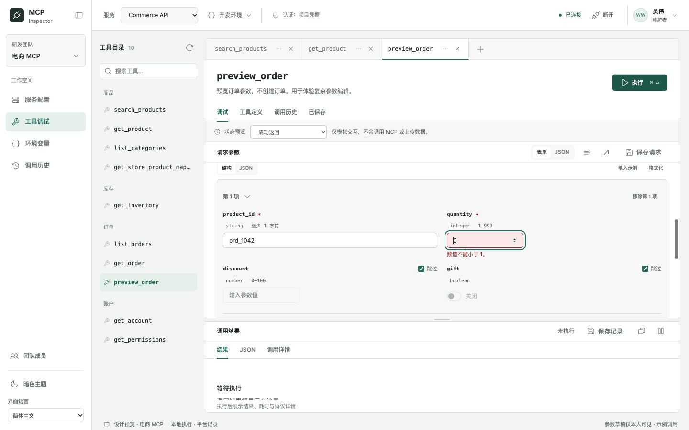
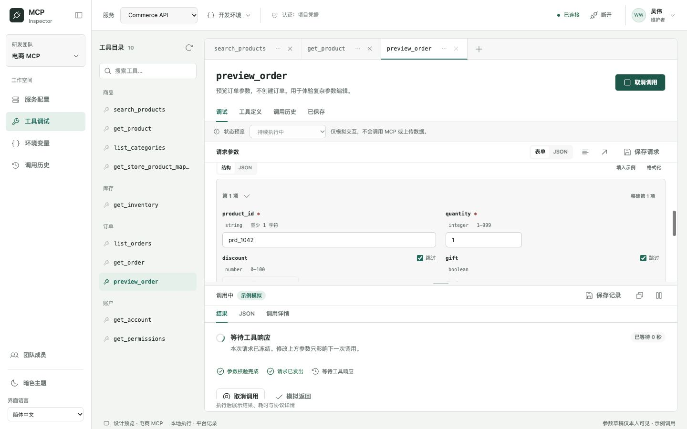
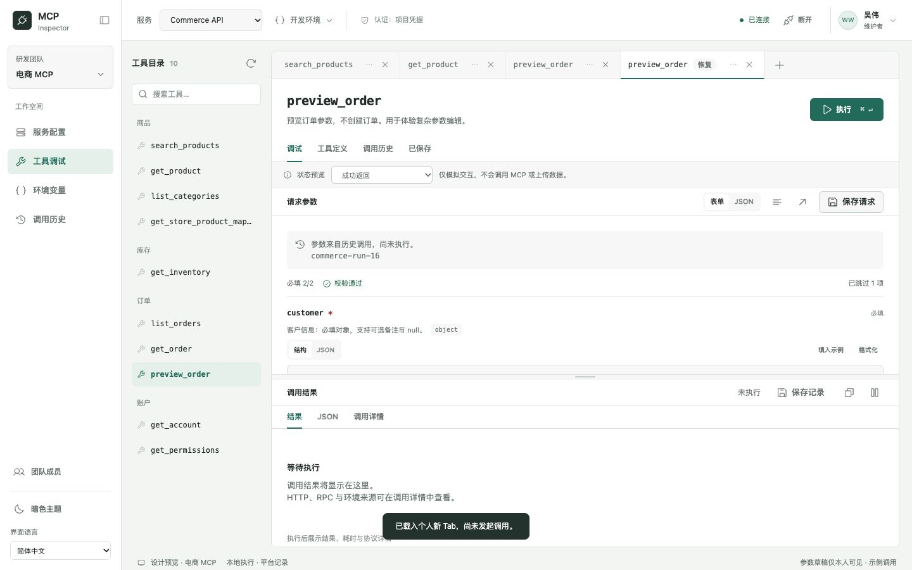
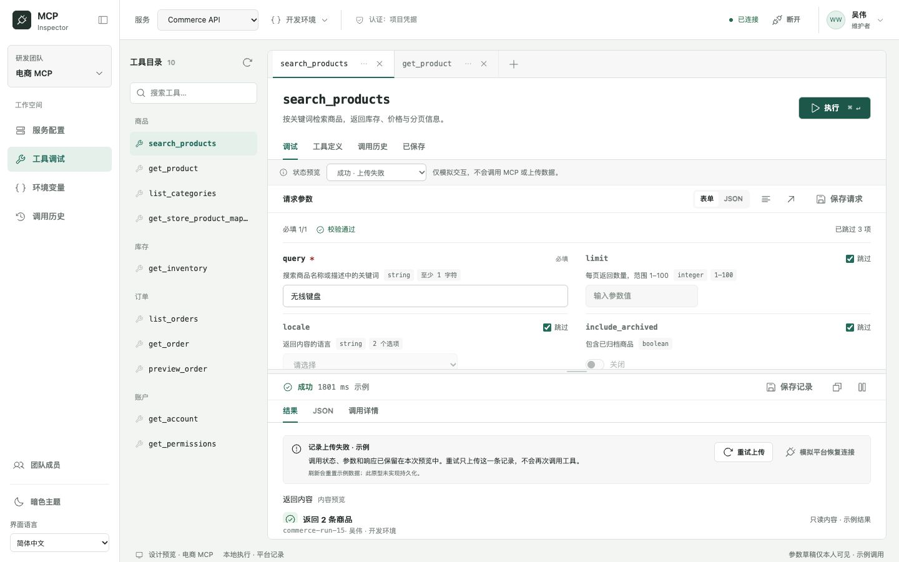
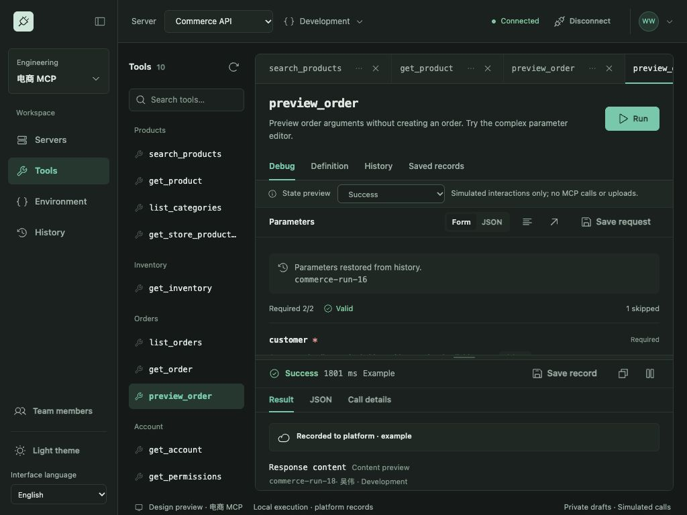

# Tools 调试：完整状态与交互原型

日期：2026-10-12。交付仅位于 `docs/redesign/`，延续已选定的工具目录 / 文档 Tab / 上方参数 / 下方结果布局。未接入 MCP、Go Agent、平台上传、数据库或正式前端；示例业务状态只保存在内存，刷新重置。

## 如何评审

打开 [工具工作台](http://127.0.0.1:8861/workbench-preview.html?page=tools&project=commerce&tab=tab-11)。参数区上方的“状态预览”是原型演示入口，不属于正式产品功能。选择情境后点执行：

| 情境 | 可体验的结果 |
| --- | --- |
| 成功返回 | 执行中 → 成功响应 → 上传中 → 已记录 |
| 持续执行中 | 保持等待，实时显示等待秒数；可取消或“模拟返回” |
| 工具业务错误 | HTTP 200、`isError: true`，保留业务错误与原始 MCP 响应 |
| 协议错误 | JSON-RPC error；与工具业务错误分别展示 |
| 授权失效 | HTTP 401；从结果页检查当前连接的认证配置 |
| 连接中断 | 未收到 HTTP 响应，明确远端结果未知 |
| 调用超时 | 超时错误，明确远端结果未知，不自动重试 |
| 成功 · 上传失败 | 调用成功、响应保留；上传单独失败，可重试和模拟恢复连接 |

取消由执行中状态的“取消调用”触发。普通情境约 1.8 秒返回，记录上传约 0.9 秒，都是演示节奏，不能作为正式请求超时或网络耗时指标。

在目录选择 `preview_order` 体验嵌套对象和对象数组；这个工具只展示参数，不创建订单。

## 参数编辑

保留普通字段两列、数字短输入、枚举选择和布尔开关。对象 / 数组占整行，支持结构与 JSON 两种方式；结构模式使用字段组、数组项展开、增删行和就近校验。嵌套参数显示类型、范围和必填标记。JSON 模式可粘贴完整值、格式化或填入示例。

新草稿的可选项在所有对象层级默认跳过，即使示例或 Schema 有默认值。取消跳过初始化值；聚焦和离开未输入的字段不报错。即使此前执行过，重新取消跳过仍等待用户编辑或下一次执行。新增数组行也先等待输入，执行时统一校验；已有其他字段的错误继续保留。

| 值或动作 | 请求语义 |
| --- | --- |
| 勾选跳过 | 删除字段；不发送、不校验该字段的值 |
| `""` / 空数字输入 | 显式空字符串 / `null`；根据 Schema 校验，不能自动省略或转换成 0 |
| `0` / `false` | 保留原值；按范围和类型校验 |
| nullable 字段的“空值” | 显式发送 `null`，与跳过不同 |
| 数组为空 / 缺少必填对象 | 分别按 minItems / required 校验 |
| JSON 语法错误 | 保留原文及上一份可解析值；禁止执行、保存未解析请求和切到结构模式 |
| JSON 可解析但 Schema 错误 | 可以切回结构模式修正；执行受阻 |
| Raw 省略必填复杂参数后回到表单 | 仍展示必填区域；输入子字段或添加数组项可恢复，不强迫使用示例 |

校验继续使用现有共享 Schema validator 的本地 bundle。错误在字段下展示，同时提供路径列表；点击 `/items/0/quantity` 一类路径会展开相应数组项并定位输入，执行时聚焦首个错误。缺失整个对象时聚焦该字段组。两种编辑方式、保存请求与执行快照使用同一参数状态。

原型中的结构控件覆盖演示 Schema 的对象、数组、string、number、integer、boolean、enum 和 nullable 字段；其他复杂 Schema 仍需依赖正式编辑器及共享校验器，不将这份字符串原型视为通用 JSON Schema 表单库。

## 执行、取消与错误

执行前完整校验，校验不通过不创建调用记录，也不清除上一次响应。执行后立即冻结项目、连接、Tab、Run、环境、地址、参数和草稿版本。修改输入只影响下一次调用；本次请求快照保持只读。运行中的 Tab 不能关闭，快捷键重复执行不会发起第二次请求。

执行中展示校验完成 / 已发出 / 等待响应三个阶段与等待时间。取消保留同一个 Run ID，终止等待并产生取消历史；迟到的模拟返回不会把取消改成成功。文案明确取消不等于远端回滚，连接中断和超时也不能推断工具是否已经执行。

错误区显示错误类别、原因、错误码与修复方向。手动“重新执行当前参数”仍经过参数和连接校验；授权 / 连接错误可检查当前连接。业务错误的 HTTP 200 不伪装成 401；无响应时不伪造 HTTP 成功。调用详情包含脱敏请求、JSON-RPC 发送 / 接收快照和时间线。

## 历史、恢复与记录上传

工具内历史继续限定 `projectId + connectionId + toolName`，并保留页面式详情。恢复创建新的未执行个人 Tab，保留显式可选参数、`null`、`0`、`false`，不覆盖已有草稿、不重放旧响应、不自动调用。下一次执行使用当前连接和环境，重新通过当前 Schema 校验；原历史环境仍可在只读详情查看。

执行状态与平台记录状态独立。结果区、工具历史、项目历史与历史详情共享同一条 Run 的记录状态：

| 记录状态 | 交互 |
| --- | --- |
| 等待上传 | 队列示例可手动“上传记录” |
| 正在上传 | 显示传输状态，禁止重复提交上传 |
| 已记录 | 保留原 Run 身份、参数及响应 |
| 上传失败 | 保留执行结果；可重试，平台离线时再次失败，模拟恢复连接后可成功 |

重试只上传原记录，不重新执行 Tool、不创建新 Run、不采集已修改的参数。上传失败时仍可将现有响应保存为记录；保存请求 / 请求加响应继续使用原有页内编辑器。记录保存是内存演示，不代表完成真实平台持久化。

原型显式说明刷新会丢失示例数据。正式产品的离线队列、凭据保存、脱敏上传、幂等和持久化策略仍需在另一个开发目录实现与验收。

## 组件与验证

- `SchemaArgumentEditor / NestedObjectFields / ArrayItemEditor / ParameterIssueList`：参数输入、跳过、错误路径与结构 / JSON 切换；状态属于 Tab。
- `ExecutionStatePanel`：运行阶段、等待时间、取消和只读请求快照。
- `ToolErrorPanel`：错误类别、恢复动作及只读历史说明。
- `PlatformRecordStatus`：队列、上传、失败与重试；无 Tool 执行行为。
- `HistoryRestoreNotice`：历史来源与尚未执行状态。

当前 `workbench-debugger.js` 分开设计状态模型和视图模板，参数模块仍注入共享 validator；沿用统一 token、Phosphor 图标和中英文资源。正式组件契约见 [COMPONENTS.md](./COMPONENTS.md)。

模型检查共 17 项，另复核管理页面 10 项、执行设置 9 项。检查取消后的迟到响应、重复执行、冻结参数、项目 / 连接隔离、各类错误协议、上传重试和复杂参数误校验。实际浏览器检查覆盖完整路径、保存页、中文亮色 / 英文暗色以及 1440、1024、390 三种宽度，未发现页面横向溢出。未运行生产 `npm run verify`，因为本轮未改动正式产品。

```sh
node docs/redesign/verify-debugger-model.mjs
node docs/redesign/verify-management-model.mjs
node docs/redesign/verify-execution-model.mjs
```

模型报告：[调试状态](./preview-assets/debugger-model-verification.json)。浏览器报告：[交互检查](./preview-assets/debugger-browser-verification.json)。






