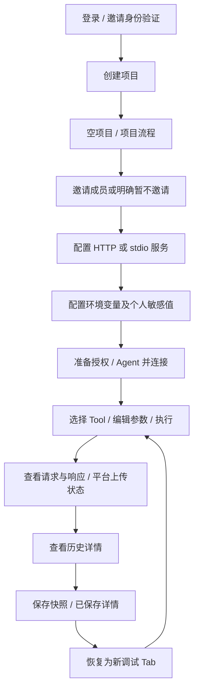

# 02 · 核心流程与交互

[交付首页](./README.md) · [页面结构](./01-pages-and-navigation.md)

## 从空项目到第一条可复用记录

项目流程页将上述步骤归纳为创建、邀请、服务、环境、调试、查看历史、保存记录 7 项。邀请及无变量情境允许明确跳过；进度来自实际记录。历史查看与保存必须对应同一次执行，上传失败不能被标成已完成。失败或取消的调用仍是实际执行记录，不得从流程中隐去。

## F00 · 登录、身份修复与会话

- 首次部署通过一次性初始化凭证创建 Owner；初始化后关闭入口。普通加入使用邀请，不开放公开注册。
- 新受邀者验证邮箱并设置账号；已有账号登录。错误身份、未验证或链接过期时保留来源邀请并给出对应修复动作。
- 验证成功返回原邀请，再检查有效期 / 撤销状态；不自动接受、不把验证成功当作加入项目。
- 会话到期遮蔽工作内容、服务上下文及项目进度，暂停上传；失败认证不恢复访问，同账号成功认证后按有效权限继续。
- 正常退出先处理未上传记录：返回队列或明确丢弃后退出。平台会话、MCP 上游授权、Agent 配对有各自生命周期。

## F01 · 创建与切换项目

- **入口**：侧栏项目入口 → 项目目录 → 创建项目。创建需要团队所有者 / 管理员能力。
- **输入**：名称、描述。提交时校验空名称与重名；错误放在字段旁，保留原文。
- **提交中**：按钮保持宽度、阻止双击。失败留在创建页，可重试。
- **成功**：生成新项目和创建者的项目维护者身份，进入空项目。不能复制示例服务、Token、变量、历史。
- **切换**：另一项目加载自己的服务、环境、草稿与记录。返回原项目仍是该项目草稿及角色能力；不自动发起调用。目标项目不能沿用前一项目角色；后台上传始终检查记录所属项目权限。

创建结果、临时草稿和迟到异步回调须绑定来源上下文；项目名称在团队内去首尾空白、忽略大小写后唯一，改名不改 ID；正式后端通过幂等和事务防止重复创建。

## F02 · 邀请、接受与成员调整

1. 项目成员 → 邀请成员，输入邮箱、项目、团队角色、项目角色和 1 / 7 / 30 天有效期。
2. 默认“团队成员 + 本项目开发者”。右侧摘要说明实际授予范围；提交前校验格式、待处理重复邀请、已有项目成员。
3. 创建后只生成邀请，不提前增加成员。详情可看状态和到期时间；原型不发送邮件。
4. 受邀者打开接受页：未登录先登录；未验证先验证；邮箱不匹配提示切换账号。完成身份修复后仍需显式接受。
5. 接受中防重复；完成时重新检查有效期、撤销状态及成员关系。失败保留邀请供重试；重复访问已接受邀请不重复加入。
6. 过期邀请可由有权人员重发，产生新 ID 和新的 7 天期限；旧邀请及同项目同邮箱其他有效邀请标为已替代。已接受邀请无重发。
7. 项目移除和团队移除使用不同页内确认，列出人名、范围和影响。自我、所有者及最后一位维护者保护见 [权限规范](./05-permissions-and-collaboration.md)。

## F03 · HTTP 服务配置与连接

**配置与连接是两个动作。** 维护者编辑共享配置；有执行权限的成员管理自己的连接会话与授权。

1. 服务页选择 / 新建服务，填写名称、环境、超时、HTTP 地址、浏览器 / Agent 通道及请求头引用。
2. 保存前校验 URL、必填项、环境引用。已确认允许非敏感 query 及非敏感变量引用，禁止内嵌凭据、fragment 和认证秘密。原型已允许公开 query 并检查变量来源。
3. 未保存时连接按钮给出先保存的提示；连接中及已连接时锁定相关配置，修改前先断开。
4. 选择个人授权方式并准备凭据；若走 Agent，先配对且确保在线。
5. 点击连接，展示解析 / 握手 / 工具目录等阶段，允许取消。成功后显示已连接及“打开工具”。
6. 失败留在当前连接，显示原因与恢复动作：网络检查、授权页、超时 / 协议配置检查等。缺失变量的按钮直接进入该服务生效环境的引用检查；修复后清除失效诊断，用户手动重连。

浏览器 CORS 受限时提供“切换至本机 Agent”；必须由用户触发，保存配置并手动重连。不能自动换通道后使用另一份凭据。localhost 指用户电脑的服务地址；浏览器安全策略、跨域和权限仍可能限制访问。

## F04 · stdio 与本机 Agent

1. 协议选择 stdio 后固定 Agent 通道，隐藏 HTTP 地址 / Header / HTTP OAuth 字段。
2. 输入命令、JSON 字符串数组参数、可选绝对工作目录；敏感环境变量从环境模块解析。配置校验不执行命令。
3. Agent 页面核对工作台来源、用户及连接标识，发起配对；用户在本机确认。拒绝、过期、不兼容、离线分别显示。
4. 配对成功只说明设备可用，回连接页手动建立 MCP 会话才启动相应流程。
5. 命令不存在 / 进程退出时保留诊断，检查命令、目录、参数和环境；错误不得泄露真实敏感启动值。
6. Agent 离线终止其会话可用性；执行中的调用记录连接中断。恢复设备后仍须手动连接 MCP。
7. 解除配对需页内确认，不删除共享服务配置，不声称擦除所有本机数据。

普通网页不能直接启动任意本机进程，stdio 的执行端必须是 Agent。已确认回环接口、Host / Origin 校验、短期配对令牌和本机确认；安装提供 macOS / Windows 包与 Linux 命令行。安装衔接与执行配置确认已有原型；安全协议仍需工程规格与真实兼容验证。

## F05 · 个人授权、保存及备份

授权页始终显示“当前用户 + 项目 + 连接”。相同地址的两个连接不互用授权。

- **环境引用**：从当前项目、服务、环境的敏感变量定义中选择，显示引用名及真实可用 / 缺失状态；保留失效的已选引用供修复，不能借用其他项目变量或把缺少个人值标成可用。进入环境页管理个人敏感值。
- **OAuth**：展示目标服务、身份及申请权限 → 等待 → 成功 / 拒绝 / 过期 / 回调失败 / 取消。成功为“已授权，待连接”，不自动连接。
- **凭据保存**：会话或本机凭据库。保存失败保留草稿，可重试或改用会话；保存位置变更不撤销已完成授权，但要求重新保存。
- **个人平台备份**：默认关闭；明确确认对象与仅本人范围后，在凭据保存成功后独立上传。失败不影响本地凭据；重试不重新授权、连接或调用工具。
- **更换 / 移除**：按当前连接处理；移除确认前凭据仍可用。过期则清除可用状态并引导重新授权。

凭据备份与平台调用记录是独立选项：不备份凭据也应按记录策略上传已脱敏的调用参数和响应。长期本地凭据使用 Agent 系统凭据库；平台备份使用托管密钥加密，不是端到端加密。新设备恢复须重新验证身份并保有项目权限；删除本机值、删除平台备份与撤销上游授权分别操作。

## F06 · 环境浏览、覆盖与应用

1. 环境页选择基础 / 开发 / 预发等环境，只切换预览。
2. 生效预览一名一行，显示最终值、来源、敏感标记；按名称、缺失、覆盖、敏感筛选。
3. 来源详情按 **基础项目 < 当前环境项目 < 基础服务 < 当前环境服务** 显示四层。可编辑来源或创建当前层覆盖。
4. 编辑页提交时校验名称、同层唯一性、类型与必需值；错误定位字段。删除覆盖先确认，删除后回退到下一有效定义。
5. 高层敏感定义存在但个人值缺失时阻断，不能悄悄使用低层值。
6. “检查引用”列出服务授权、请求头、stdio 配置和变量依赖的问题；分别处理缺失定义、缺失个人值、必需空值和循环引用。
7. “用于我的会话”仅在服务未连接、无连接中任务、配置已保存且环境无阻断问题时可用；成功更新会话环境，不自动连接。

开发者编辑个人敏感值时锁定共享定义字段。更换值使旧备份过期；移除本地值、恢复备份、删除备份是独立确认动作。派生变量继承敏感性，脱敏快照不能经拼接或嵌套 JSON 回显秘密。

## F07 · 参数输入与调试

| 用户动作 | 预期行为 |
| --- | --- |
| 打开 Tool | 创建 / 选择对应 Tab，显示类型、必需、描述及参数编辑器 |
| 初次显示可选字段 | 所有对象层级默认跳过；即使 Schema 提供默认值也不自动发送 |
| 取消跳过 | 初始化编辑值；不因这一动作、聚焦或离焦马上报错 |
| 实际编辑 | 根据编辑状态就近反馈；已有其他字段错误保留 |
| 新增数组项 | 新项先等待输入；执行时完整检查必填、类型与约束 |
| 选择空值 | 仅 nullable 字段可显式发送 null，与省略字段不同 |
| Raw JSON 语法错误 | 保留原文和上一可解析值；禁止执行、保存未解析请求、切回结构模式 |
| JSON 合法但 Schema 不符 | 可以切回结构模式修正；可以保存私有“未完成请求草稿”，不可执行或发布 |
| 点击执行 | 全量校验、定位首个错误；无效时不创建 Run、不清除上次响应 |
| 合法执行 | 冻结参数与上下文，创建 Run；草稿后续编辑只影响下次调用 |

嵌套错误路径如 `/items/0/quantity` 点击后展开祖先与数组项，并聚焦字段；缺少整个必填对象时聚焦对象组。数字 `0`、布尔 `false`、空字符串、null、字段缺失不能相互混淆。完整语义见 [04](./04-states-and-data.md)。

## F08 · 执行、取消与错误恢复

每次新项目调用先校验平台权限及容量；平台离线时不发起新调用，已发出调用可结束并排队。执行中显示阶段、等待时间与取消操作。重复点击或快捷键不启动第二次同 Tab 调用；运行中的 Tab 不能关闭。

- 成功：展示请求与响应、协议上下文、耗时；独立展示平台记录状态。
- 工具业务错误：保留 `isError: true` 与真实协议响应；HTTP 200 仍可能是工具业务失败。
- 协议错误：展示 JSON-RPC error，与业务失败区分。
- 授权失效：跳至当前连接的授权配置；不会代用其他连接凭据。
- 网络中断 / 超时：明确远端结果未知，不自动重新执行。
- 取消：保留相同 Run ID 与已发送请求；迟到返回不把取消改为成功。取消等待不表示远端回滚。

“重新执行当前参数”是一次新的显式调用，重新校验当前草稿、环境、权限和连接；不能把它命名成记录上传重试。

## F09 · 历史、脱敏、恢复与保存

1. 工具内历史限定项目 + 连接 + 工具；项目历史可以跨服务筛选。两个入口共用展示组件，不共用未限定范围的数据。
2. 筛选支持搜索、结果、上传状态、服务（总历史）、环境、操作者、日期；保存列表另有范围与内容类型。无匹配时清除筛选；日期顺序错误就近说明。
3. 详情只读展示请求、响应、执行上下文、脱敏路径和上传状态。缺少响应、来源失效、工具移除分别提示。
4. 恢复生成**新的未执行 Tab**。保留 0 / false / null 和历史显式可选值；带脱敏占位符的顶层参数整项移除并提示补齐。使用当前 Schema、环境及个人授权。
5. “保存请求”以草稿为来源；“保存记录”以已冻结 Run 为来源。打开保存页即冻结来源，名称必填，备注可选，默认仅本人可见。
6. 保存记录获得独立 ID、保存时间及自己的上传快照，不继承来源 Run 的上传缓存 / 丢弃状态。浏览器执行“保存记录”产生的保存任务由浏览器负责；来源 Run 的 Agent / 浏览器执行信息仅保留作追溯。
7. 修改名称 / 备注 / 范围是显式记录修订：保持保存记录 ID 与请求响应不变，为此次修订冻结包含新元数据的上传内容；不是以旧上传任务重试新内容。删除保存记录不删除原调用；历史被清理后保存快照仍存在。
8. 上传失败保留本次保存 / 修订的脱敏队列快照；点击重试只上传同 ID、同快照，不重新读取已变化的草稿、不创建新 Run、不调用 Tool。

脱敏覆盖请求、响应、协议、复制、保存和上传，自动规则不能关闭；用户附加 JSON Pointer、原因和待提交修订内容均按项目 + 当前记录定位；切换另一记录再返回时不能写错表单。已上传记录的本地脱敏预览修改不等于服务器历史已重写。正式流程已确认支持追加脱敏修订：维护者处理项目记录，有写权限的本人处理私有记录；同步关联保存副本与缓存，审计仅保留修订元数据，不保留被删除的秘密原文。

## 全流程返回与恢复原则

失败保留输入和上下文；正常取消返回来源页面；修复前置条件后由用户再次触发有副作用动作。长流程不能靠 Toast 承载唯一诊断，下一步操作应留在当前页面。模拟延迟不作为正式 SLA，模拟成功按钮不移植到正式产品。

## Baseline 2 · 账号、接管和本地数据补充

- 内部版只通过邀请加入，采用邮箱密码；邮件承担验证、邀请、找回。一次性初始化完成即关闭 Owner 创建入口。SSO 后续接入。
- 团队 Admin 管理目录和成员，不自动查看未加入项目内容；Owner 通过确认和审计为自己增加维护者身份后才能访问。个人数据边界不因接管改变。
- 固定仅维护者操作；上传重试仅本人且有执行权限时处理本人责任端队列。平台内部失败由内部任务恢复，不借用别人的本地记录。
- 浏览器直连由浏览器排队，Agent 调用由 Agent 排队，每个 Run 一个责任端；平台按身份及内容摘要幂等，冲突不能覆盖。
- 浏览器刷新只能恢复已持久化脱敏记录，不能承诺恢复原始响应或未结束请求；Agent 可完成已获准的调用，但后续上传仍需平台身份。
- 退出前提示未上传记录，允许返回处理或明确丢弃后退出；会话到期暂停上传，同账号重认证后继续。不同账号不能访问前一用户缓存。
- 普通历史保留 90 天；固定与已保存不被该清理规则删除但占容量。响应留存超 10 MiB 显示截断 / 省略，不能伪装完整；本地队列满时停止新调用并引导处理。
- 配置并发保存采用版本校验；冲突保留本地草稿，比较后再保存，不静默覆盖别人的改动。

以上为已确认目标；静态交互同步见 [09](./09-baseline-v2-prototype-sync.md)，不代表后端或本机存储已经实现。详见 [决策记录](./08-decision-proposals.md)。
