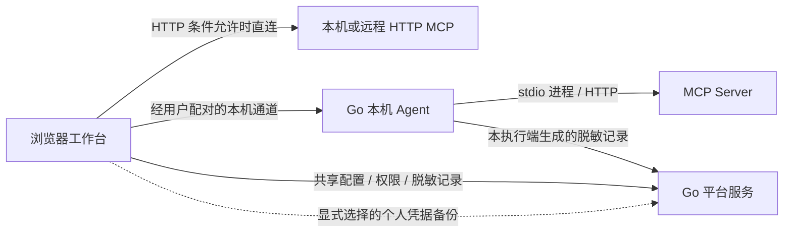
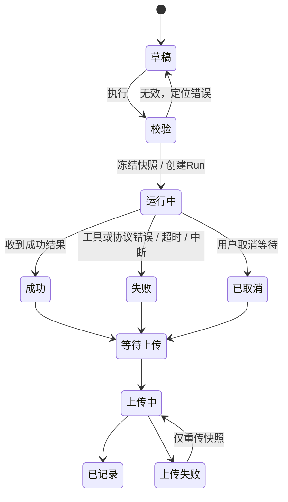

# 04 · 状态与数据契约

[交付首页](./README.md) · [权限规则](./05-permissions-and-collaboration.md)

## 执行与存储责任

前端发起调试与编排；远程 / localhost HTTP 在浏览器允许时由浏览器直连，受限或需本机凭据时由用户明确切换 Agent，stdio 固定 Agent。平台后端默认不代调 MCP。浏览器直连的记录由浏览器排队；Agent 调用的记录由 Agent 排队，一个 Run 只有一个责任端。平台负责权限、配置和脱敏记录，调用前权限校验不改变实际执行方。

| 数据 | 所属边界 | 存储 / 传播规则 |
| --- | --- | --- |
| 用户、团队及项目关系 | 用户 / 团队 / 项目 | 平台权威；前端展示能力不能代替服务端校验 |
| 服务非敏感配置 | 项目 + 连接 ID | 项目共享；认证方式可共享，个人认证值不共享 |
| 环境定义 | 项目 + 环境 + 作用域 + 可选连接 ID | 共享定义及非敏感值；个人敏感值分离 |
| MCP 凭据 | 用户 + 项目 + 连接 ID | 会话或 Agent 本机凭据库；显式开启才做个人平台备份 |
| 敏感变量值 | 用户 + 项目 + 变量 ID | 按定义所属环境 / 服务限制使用；不会变成团队共享值 |
| Agent 配对及连接会话 | 用户 + 项目 + 连接，关联设备 / 尝试 ID | 原型按连接隔离；正式设备复用不取消连接授权边界 |
| 参数草稿 | 用户 + 项目 + 连接 + Tab | 当前个人编辑状态；跨 Tab / 项目不覆盖 |
| Run | 项目 + 连接 + Tab + Run ID | 一次执行的不可变请求及结果快照；记录操作者与执行上下文 |
| 已保存记录 | 项目 + 记录 ID + owner + scope | 独立于 Run；仅请求或请求响应；私有默认 |
| 上传任务 | 用户 + 项目 + 连接 + 记录种类 + 记录 ID + 本次保存 / 修订身份 | 同一次上传重试复用身份与快照；显式元数据修订使用独立操作身份；执行状态独立 |
| 语言 / 主题 | 用户偏好 | 原型仅此两类写浏览器偏好存储；不存 Token、草稿或响应 |

这是设计层逻辑数据合同，不是数据库 DDL。原型部分字段名为 `serverId`，其语义是连接配置身份，不是 URL 或域名。正式命名需统一。

## 通用页面状态

| 状态 | 内容与操作 | 约束 |
| --- | --- | --- |
| initial / 未执行 | 保留页面结构与合理默认 | 结果区显示未执行，不出现伪成功数据 |
| loading | 就地骨架 / 进度、明确作用区域 | 阻止重复动作；正式加载来自真实请求生命周期 |
| empty | 对象为空的说明 + 可用下一步 | 无记录引导调试；无服务引导配置；不可把没权限当成空数据 |
| no-match | 筛选条件与清除筛选 | 不引导用户重复创建已存在对象 |
| ready | 真实上下文与允许动作 | 不读无权限对象 |
| error | 发生什么、可能原因、下一步 | 重试保留上下文；不能只有“操作失败” |
| forbidden | 权限不足说明、返回 / 联系维护者 | 不渲染敏感数据，不把隐藏按钮当权限验证 |
| missing | 对象不存在或已不可访问、返回入口 | 保留可合法展示的历史快照，不猜测当前配置 |
| read-only | 内容可读、写操作不可用并解释 | 与完全无法访问区分 |
| stale | 草稿 / 配置或结果版本不一致提示 | 不能把旧结果挂到新参数上当成新结果 |

原型 `uiState=ready/empty/loading/error/forbidden/missing` 用于评审；不是生产查询参数能力。错误及空态优先用页内反馈；短复制成功等用一次轻提示。

建议保持统一的短文案结构，例如“记录上传失败 / 调用结果已保留 / 重试上传”，英文对应 “Record upload failed / The call result is retained / Retry upload”。不能用“重试”同时指重新执行与重新上传。

## 相互独立的状态轴

| 对象 | 状态与关键转换 | 失败 / 取消后的语义 |
| --- | --- | --- |
| 配置草稿 | clean → dirty → saving → saved / failed | 失败保留输入；未保存禁止连接 |
| MCP 连接 | disconnected → connecting → connected / failed / cancelled → disconnected | 迟到尝试不能覆盖后续会话；连接成功才开放工具执行 |
| Agent | unpaired → pairing → paired-online；paired-offline；rejected / expired / incompatible | 配对成功不连接 MCP；离线保留配对身份但会话不可用 |
| OAuth | unauthenticated → authorizing → authorized / denied / expired / callback-failed / cancelled | 授权成功不代表已保存或已连接；过期不可执行 |
| 凭据保存 | unsaved → saving → saved / failed | 失败可重试或改用会话；不偷偷改保存位置 |
| 个人备份 | off → confirming → uploading → backed-up / failed；stale | 默认关闭；值变更使旧备份过期；失败不清除本地值 |
| Run | idle → validating → running → succeeded / failed / cancelled | 校验不通过不生成 Run；超时 / 中断属于失败且远端结果可能未知 |
| 记录上传 | pending → uploading → recorded / failed → uploading | 保留同 ID、同快照；绝不执行 MCP |
| 邀请 | pending → accepted / expired / revoked / superseded | 终态旧邀请不可接受；重发是另一条邀请 |

上述名称是说明性状态，不要求正式实现原样采用枚举。设计中的约束和转换必须保留。

图中上传节点是 Run 完成后的另一状态轴，**不会替换其成功 / 失败 / 取消结果**。正式实现可记录更多阶段事件，不能由前端计时器伪造权威进度。

## 参数值、跳过及校验

| 输入状态 | 请求值 | 校验责任 |
| --- | --- | --- |
| optional + skipped | 字段不存在 | 不校验其值；不能将旧编辑值偷偷发送 |
| required | 必须存在 | 不提供跳过绕行；缺少整个复杂对象仍能定位 |
| 空 string | `""` | 根据 required / minLength / pattern 等实际 Schema 语义判断；不能统一当缺失 |
| 空 number 输入 | 待编辑空态，当前原型映射 null | 不能自动转 0；执行时按类型 / nullable 验证 |
| number 0 / boolean false | 原样保留 | 不使用真假判断检测缺失 |
| 显式 null | `null` | 仅 Schema 允许时合法，与缺失不同 |
| 空 array | `[]` | 检查 minItems，不等价于缺少参数 |
| 非法 JSON | 原文保留，不更新可发送值 | 阻止执行、保存未解析请求、切回结构模式 |
| 合法 JSON、Schema 错 | 可解析但不可执行的值 | 可返回结构模式修正；不误报 JSON 语法错 |

可选字段各层级默认跳过，显式历史值恢复时保留。跳过、null、touched、原始 JSON 和可解析值是不同状态，不能用单个空字符串概括。仅 focus / blur 或取消跳过不新增错误；实际编辑和执行触发校验。高级组合无法无损展示时使用局部 JSON 编辑与完整校验；支持文档内引用、不自动获取远程引用。合法 JSON 的 Schema 错误可保存私有未完成草稿，不可执行 / 发布；未支持的 Schema 明确阻断。细则见 08 D09。

## 环境解析

同名定义优先级：`基础项目 < 所选环境项目 < 基础服务 < 所选环境服务`。基础环境只含基础项目与基础服务两层。

- 同层唯一；跨层同名用于覆盖。只解析最终生效定义的依赖，不让被覆盖的旧值造成错误。
- `{{NAME}}` 可出现在字符串及嵌套 JSON 中；分别报告缺失定义、必需空值、个人值缺失、依赖缺失、循环引用。
- 高层定义缺少值仍占据该层，不回退到低层。删除定义才回退。
- 数字必须有限；布尔只接受 true / false；0、false 有效。普通可选字符串可为空；标记必需或直接必需引用时空白 / 空字符串 / null 为缺失。
- 直接或间接依赖敏感变量的值整体脱敏。引用快照保留变量名、来源和状态，不能包含真实值。
- 应用环境、连接前校验与执行前校验使用同一规则；变更不改写旧 Run。

## 快照与恢复

Run 应可解释“谁、在哪个项目、哪个连接、哪个 Tool 定义、哪个环境、用什么通道、何时、用什么参数调用，得到了什么结果”。记录配置 / 定义版本及凭据**来源标签**，不记录凭据值。

执行冻结后，参数编辑、切换主题、查看历史均不能修改本次快照。旧结果与新草稿不一致时明确提示。stdio 详情不能展示虚构 HTTP 200。

恢复只创建新个人草稿，重新使用当前配置、Schema 和授权。脱敏占位符不成为可发送参数；含占位符的顶层项整体移除。当前 Tool / 连接已失效时详情仍可读，但恢复入口需禁用并说明，不能随意换成同名工具或相同 URL 的连接。

### 保存记录与上传修订

- 来源 Run、独立保存记录、上传任务是三个对象。新保存记录获得独立 ID，不复制来源 Run 的上传缓存、上传重试计数或队列丢弃状态。
- 浏览器中的“保存记录”建立浏览器责任端队列；来源 Run 即使通过 Agent 执行，也不使新保存任务冒用 Agent 队列。执行来源仍保留在追溯信息中。
- 编辑名称 / 备注 / 可见范围不改请求响应；显式保存为新修订冻结新元数据。保存时间反映实际保存事件，不使用固定示例时间。
- **重试和修订不可混同**：同一上传操作必须同 ID / 同摘要；新的显式修订需要独立操作身份及版本检查，不能绕过冲突保护直接覆盖。具体修订字段、OpenAPI 和幂等键留给新目录工程合同，语义已确定。
- 后台上传按记录所属用户、项目、连接和责任端判断权限；切换屏幕到另一项目不赋予或撤销原项目权限。

## 脱敏与复制 / 上传

请求、响应、协议、默认复制、默认导出、保存和上传共用脱敏语义。原型示例覆盖凭据字段、认证头 / Cookie、敏感 URL 参数、内嵌认证、邮箱手机号字段及已识别值回显。自定义 JSON Pointer、修订原因及未提交内容按项目 + 记录 ID 隔离；只能追加；无效路径报错；自动规则不可关闭。

已确认脱敏采用来源敏感标签、默认规则、项目规则、单记录追加规则和接收端复核；原型正则不能保证业务信息安全。项目维护者可追加脱敏修订项目记录，本人有写权限时可修订私有记录，同步关联保存副本 / 缓存，审计不保留已删除秘密。无法可靠脱敏的二进制 / 大内容只上传元数据和省略说明。保留 / 删除政策按 08 D14。

## 异步身份与重复操作

每次结果提交 UI 前校验项目、连接、Tab、Run / 记录及操作代次。切换页面后迟到回调不能污染新上下文。运行、连接、保存、邀请及上传中均防重复；上传重试使用原记录幂等身份。

本地停止等待不等于远端事务撤销。权限撤销、设备离线或页面关闭后的结果查询、队列恢复和运行中操作清理需要正式后端 / Agent 契约，原型不提供生产保证。

## Baseline 2 · 持久化、容量与访问状态

| 状态 / 数据 | 已确认语义 |
| --- | --- |
| 浏览器脱敏缓存 | IndexedDB 按用户 / 项目隔离；公共设备可选仅内存。禁止真实凭据和原始敏感内容进入浏览器持久化；存储可能被清理，不承诺绝不丢失 |
| Agent 本地数据 | 加密队列，主密钥由系统凭据库保护；可完成已获准的调用，上传需有效身份 |
| 平台离线 | 阻止新项目调用，已发出调用可结束并排队；不自动重放 |
| 备份 | 默认关闭，个人显式开启，平台托管密钥加密而非端到端加密；恢复需重新认证且仍有项目权限 |
| 会话到期 / 退出 | 到期暂停上传、遮蔽缓存，同账号重认证可继续；正常退出处理待上传提醒后撤销会话并清理浏览器缓存 |
| 同 ID 上传 | 同身份同快照幂等；不同摘要报冲突，不覆盖 |
| 未完成私有草稿 | JSON 可解析、Schema 错，可存且脱敏，不可发布或执行；与 Run 状态和上传状态分别管理 |
| 记录修订 | 显式追加脱敏、更新关联快照和缓存；只留审计元数据，不以不可变快照为由保留泄漏秘密 |
| 角色降级 | Viewer 可读可见记录但不能写、恢复执行或上传重试 |
| 成员移除 | 立即撤销项目平台访问，私有记录封存 30 天；在线个人凭据备份删除，备份介质最多 30 天淘汰 |
| 历史 / 保存 | 普通历史 90 天；固定与保存记录不随该期限清理，仍计容量 |
| 容量 | 项目默认 5 GiB；请求 1 MiB；响应留存 10 MiB；队列每账号 / 项目 1,000 条或 100 MiB，先到为准 |
| 队列滞留 / 满 | 7 天提醒但不自动删除；满时停止新调用，先重试或明确处理；实际资源不足必须说明无法保留 |
| 截断 / 省略 | 明确标记、不伪装完整响应；截断的结构不能当作完整 JSON 或完整附件使用 |
| 配置版本冲突 | 条件更新失败时保留本地草稿，比较再保存；禁止静默覆盖 |

详细默认值和权限见 [08 D01–D15](./08-decision-proposals.md)。这些是正式设计契约；现有原型仍为内存模拟，既有报告不验证上述持久化或鉴权能力。
