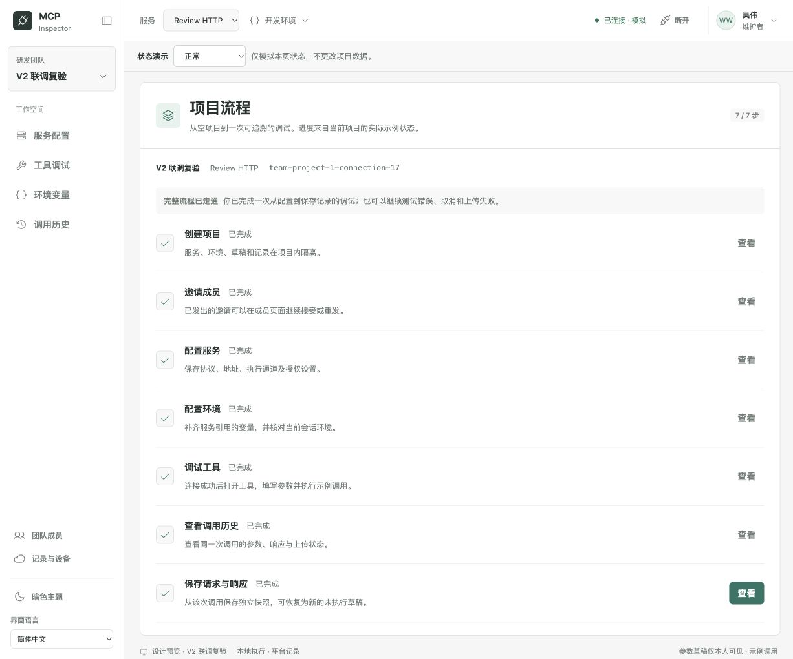

# 10 · Baseline 2 连续流程复核

日期：2026-10-12。范围：静态交互原型、设计说明和原型回归检查。沿用现有布局与组件，**未进入正式产品开发**。

## 连续走查结果

在同一浏览器会话内，使用页面按钮连续完成以下流程；步骤之间没有通过重载或直接地址重建示例状态：

1. 邮箱登录 → 项目管理 → 创建空项目；空名称有行内校验，提交显示处理中。
2. 邀请开发者 → 接收预览 → 尚未登录时禁止接受 → 登录返回同一邀请 → 显式接受。
3. 新建 HTTP 服务 → 浏览器直连 → 保存附加请求头变量引用；引用未定义时禁止连接。
4. 进入当前服务、当前环境的缺失检查 → 补齐服务变量 → 保存 → 返回连接。
5. 模拟网络不可达 → 保留配置重试 → 打开工具 → 空必填校验 → 持续执行 → 取消 → 再执行。
6. 成功调用但历史上传失败 → 查看同一 Run → 模拟平台恢复 → 重试上传；不重放工具。
7. 保存独立命名快照 → 模拟保存上传失败 → 恢复并重试 → 项目流程显示 **7 / 7**。
8. 从保存记录恢复 → 新 Tab 保留请求参数，结果为“未执行”，不会加载旧响应或自动调用。

修订后重新创建“V2 联调复验”项目，走通邀请过期 / 重发 / 接受、服务、缺失变量、调试、历史、保存和名称修订，再次到达 7 / 7。

## 发现并修补的遗漏

| 问题 | 修订后的规则 / 交互 |
| --- | --- |
| 缺失环境变量诊断仍链接到连接配置 | “检查环境变量”进入所选服务的生效环境与引用检查；修复后清除失效诊断 |
| 授权引用使用预设项目名称，不能选择新项目的变量 | 选项来自当前项目、服务、环境的敏感变量；保留尚未解析的已选引用并提示缺失；不展示其他项目变量 |
| 保存快照复制了来源调用的上传缓存 | 新保存记录冻结自己的 ID、名称、范围及脱敏快照；从浏览器保存的记录由浏览器队列负责；来源调用不变 |
| 修改已保存记录可能继续上传旧名称 | 显式保存形成新的上传快照，重试仍使用该次保存的同一快照 |
| 保存时间写死为示例时间 | 显示本次模拟保存的时间 |
| 项目角色预览随项目切换沿用；后台上传依赖当前屏幕角色 | 项目各自保存角色预览；上传检查记录所属项目的权限；接管其他项目不改变当前项目角色 |
| 成员失去访问权后仍可能进入项目成员管理 | 普通成员的管理与内容入口均阻止；团队管理员保留目录管理权限，不因此获得项目内容或个人凭据 |
| 会话到期 / 无访问权页面可能保留服务上下文及流程进度 | 隐藏服务上下文与进度；认证页不展示项目进度。团队角色预览在两个入口同步 |
| 交替查看多条记录后，脱敏原因可能写入最近创建的另一条表单 | 原因与提交情景按项目 + 当前记录 ID 定位，保留各自未提交内容 |

## 权限与异常复验

- **Viewer**：执行、保存请求和新增服务禁用；切换项目后使用目标项目角色，切回恢复原项目角色。
- **Developer**：可执行；固定、项目发布等维护权限继续由既有模型检查覆盖。
- **无项目成员关系**：普通成员不能管理成员，服务上下文不显示；Admin 可管理目录与成员，不能自行接管。
- **Owner**：接管必须填写原因，确认后才恢复访问；操作不改变其他项目的角色预览。
- **邀请**：未登录禁止接受；认证后回原邀请但不自动接受；过期禁止接受，重发生成新邀请。
- **会话**：到期遮蔽内容；验证失败不恢复权限，成功后可继续使用。
- **执行与记录**：执行中与取消有明确状态；网络失败可重试；历史及保存上传失败与 MCP 执行状态分开；恢复仅创建新草稿。

## 验证与交付边界

- 本轮新增 **14 项**针对上述遗漏的原型模型检查；现有 **195 项**当前原型模型检查重新通过，合计 **209 项**。JavaScript 语法检查通过。
- 浏览器完成上述两条连续旅程及角色、会话、过期邀请和修复入口复验；控制台未捕获错误。详见 [连续旅程证据](../preview-assets/journey-v2-browser-verification.json) 与 [新增模型报告](../preview-assets/journey-v2-model-verification.json)。
- 前轮 120 组布局检查是历史证据，本轮不将其计作重新执行。此次不调整视觉系统。
- 仅修改 `docs/redesign/`；仓库其他已有改动不属于本轮。未运行生产构建或生产验收，不把原型检查当作真实账号、权限、MCP、存储与 Agent 的验收。
- 所有业务数据仍在内存中，真实刷新会重置新建项目、邀请、调用与保存记录；截图记录走查完成时的状态。页面中的上传、邮件、认证均为模拟，没有真实对外操作。

后续实现继续遵守 [08 已确认规则](./08-decision-proposals.md)。本轮修订解决原型与规则的衔接问题，没有新增待确认的产品决策。
