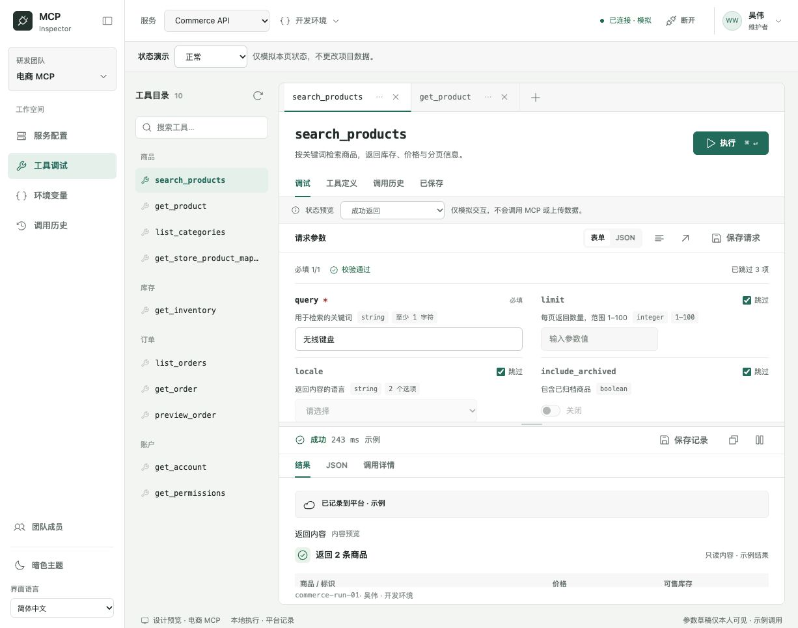

# MCP Inspector 服务版 · 设计交付

版本：2026-10-12 / Design baseline 2 · 最终整理版。交付类型：可交互原型与设计规格；**尚未进入正式产品开发**。后续在独立目录实现 Go 后端、TypeScript + React 前端与本机 Agent。

这份交付将多轮评审整理成一个入口，供产品、设计、前端、后端与测试共同使用。它描述目标行为及其边界，不是已完成服务的说明，已确定产品规则和部署形态；具体 API 字段、数据库表结构与工程版本尚未冻结。

本轮确认：[已确认规则与决策记录（D01–D15）](./08-decision-proposals.md)。用户已确认调用方式及全部推荐规则，统一纳入 baseline 2；已按该基线补齐原型，见 [09 原型同步与验证](./09-baseline-v2-prototype-sync.md)。连续流程复核及修补见 [10 连续流程复核](./10-baseline-v2-journey-review.md)。当前便携包为 `mcp-inspector-design-handoff-2026-10-12-v2-final.zip`；此前各版 ZIP 保留为对应阶段快照。最终入口为 [11 页面、交互与验收清单](./11-final-delivery-checklist.md)，含 26 个页面 / 视图条目、15 条交互链、A01–A60 及可填写的 [验收登记表](./acceptance-register-v2.csv)。

## 阅读顺序

2026-10-13 计划补充：[独立目录实施计划](./tasks/plan.md)、[开发任务与检查点](./tasks/todo.md)、[A01–A60 验收分期](./tasks/acceptance-schedule.csv)。补充明确三端模块、目录、依赖顺序与正式验收安排，尚未开始实现；不改动 D01–D15，也不覆盖 2026-10-12 最终便携包。该日期的 ZIP 不包含本次计划补充，携带计划时需一并复制 `tasks/`。

| 文档 | 回答的问题 |
| --- | --- |
| [01 页面结构与导航](./01-pages-and-navigation.md) | 有哪些页面；上下文如何隔离；从哪里进入、返回 |
| [02 核心流程与交互](./02-core-flows.md) | 从创建项目到保存结果怎么走；失败后如何继续 |
| [03 组件与视觉规范](./03-components-and-visual-spec.md) | 布局、组件责任、参数控件、双语、主题及响应式规则 |
| [04 状态与数据契约](./04-states-and-data.md) | 状态如何转换；请求、凭据、变量和记录归谁管理 |
| [05 权限与协作规则](./05-permissions-and-collaboration.md) | 团队与项目角色能做什么；邀请与成员移除如何保护 |
| [06 开发交接与验收](./06-handoff-and-acceptance.md) | 哪些规则已经确认；哪些需确定；如何验收及迁移 |
| [来源与证据索引](./07-source-and-evidence.md) | 对应原型文件、领域设计、截图及既有检查报告 |
| [08 已确认规则](./08-decision-proposals.md) | D01–D15 的决策、理由、默认值和调用责任 |
| [09 首次原型同步](./09-baseline-v2-prototype-sync.md) | v2 页面补齐与该阶段验证边界 |
| [10 连续流程复核](./10-baseline-v2-journey-review.md) | 两轮完整旅程、遗漏修补与原型证据 |
| [11 最终交付清单](./11-final-delivery-checklist.md) | 新目录接手的页面、交互、状态、验收及工程边界 |

先读本页 → 08 → 11，再根据职责阅读 01–06；07、09、10 用于追溯。组件细节保留在 [完整组件契约](../COMPONENTS.md)，各领域说明通过来源索引访问。

## 产品范围

定位：可通过浏览器访问、面向个人调试与团队协作的 MCP 工作台。优先内部部署，同时保留未来 SaaS 的租户、用户和项目边界。

| 纳入本版 | 设计范围 |
| --- | --- |
| 服务配置 | HTTP / stdio，连接与诊断，个人授权，本机 Agent，凭据保存与可选个人备份 |
| 环境变量 | 环境浏览与应用、项目 / 服务级定义、覆盖链、个人敏感值、引用与缺失校验 |
| 工具调试 | 目录、多 Tab、定义、复杂参数、跳过与校验、运行 / 取消 / 错误、工具内历史与已保存 |
| 调用历史与已保存记录 | 项目级列表与详情、筛选、脱敏、恢复、新建保存快照、上传及失败重试 |
| 项目与团队 | 创建与切换项目、成员角色、邀请创建 / 接受 / 过期 / 撤销 / 重发、移除成员 |
| 通用体验 | 中英文单语言界面、亮暗主题、可收起侧栏、桌面与窄屏、空 / 加载 / 错误 / 权限状态 |

不纳入本版：自动化测试平台、测试单元与套件、压测、报告中心、脚本流水线、Skills 管理、Prompts / Resources 管理。历史仓库包含这些能力，不代表本次重做要保留。所有权转移与全局设备管理不纳入本版。邮箱密码 / 邀请加入、Agent 安装形态和 Owner 接管规则已确认；其页面与示例交互已补入当前原型，真实身份、持久化和设备能力仍待在独立目录实现。

## 已确认的关键决策

1. 保留开发者工作台布局：侧栏 → 工具目录 → 文档 Tab → 上方参数 / 下方结果。管理页沿用同一 Shell。
2. 调试、历史、保存记录、变量编辑与团队邀请以页面承载；破坏性操作采用页内确认。工具菜单、下拉和全局账户入口仍可使用合适浮层。
3. 用户信息在右上角；主题和语言在左下，语言位于最下方。标题只显示当前语言，不并列中英文。
4. 浏览器负责交互与调试编排；远程 / localhost HTTP 在浏览器条件允许时直连，受限或使用本机凭据库时由用户切换 Agent；stdio 固定本机 Agent。平台负责权限、配置、脱敏记录及可选个人备份，默认不代发 Tool 请求。
5. 个人 MCP 授权默认留在会话或本机凭据库，显式选择后才做个人平台备份。项目成员不能因此读取凭据。
6. 可选参数默认跳过；没有编辑、仅聚焦或取消跳过不立即报错。执行前完整校验。
7. 执行状态与记录上传状态独立。上传重试不能触发 MCP 重放；历史恢复创建新的未执行 Tab。
8. 项目、连接、Tab、Run 独立标识。相同 URL 不意味着同一连接或同一授权。
9. 内部署首版采用邮箱密码 + 邀请，关闭公开注册；团队管理与项目内容访问分离，Owner 接管需显式确认并审计。
10. 浏览器仅持久化脱敏待上传记录；长期凭据保存交给 Agent。平台离线暂停新项目调用，已发出调用可结束并排队。
11. 个人备份采用平台托管密钥加密，不是端到端加密；默认关闭，仅本人且仍有项目权限时可恢复。
12. 支持私有未完成请求草稿；未通过校验不可执行或发布。正文 14px、辅助 12px、最低 11px。
13. 历史默认 90 天，已保存不随历史过期；请求 1 MiB、响应留存 10 MiB、项目默认 5 GiB。详细队列与删除政策见 08。
14. Go 模块化单体 + React / TypeScript / Vite + PostgreSQL，内部容器部署，REST / OpenAPI + SSE；首版不要求微服务或 Redis。

## 当前设计预览

- [账号与会话](../workbench-preview.html?page=account&project=commerce)
- [记录与设备](../workbench-preview.html?page=operations&project=commerce)
- [项目访问权限](../workbench-preview.html?page=access&project=commerce)

- [工具工作台](../workbench-preview.html?page=tools&project=commerce&tab=tab-11)
- [项目完整流程](../workbench-preview.html?page=project-flow&project=commerce)
- [服务与个人授权](../workbench-preview.html?page=servers&project=commerce&config=authorization&server=commerce-personal)
- [环境变量](../workbench-preview.html?page=environment&project=commerce)
- [历史详情及上传失败](../workbench-preview.html?page=history-detail&project=commerce&run=commerce-run-redaction)
- [项目与邀请](../workbench-preview.html?page=members&project=commerce&section=invitations)



上述截图用于整体外观参考；可交互 HTML 为当前入口；baseline 2 规则以 08 为准，首次同步与连续流程证据见 09–10，最终清单见 11。领域截图记录各轮评审状态，可能早于最后一次组件细节调整。

## 预览与携带方式

完整目录包含本地脚本、样式、图标、校验器及 i18next bundle，无需安装前端工程。可以直接打开 `docs/redesign/workbench-preview.html`，也可以从交付包根目录运行本地静态服务：

```sh
python3 -m http.server 8861 --bind 127.0.0.1 --directory docs/redesign
```

访问 `http://127.0.0.1:8861/workbench-preview.html`。端口已占用时使用已有预览服务，或更换端口。

预览业务数据只在内存；刷新重置。仅语言、主题偏好进入浏览器存储。状态预览、角色预览、模拟成功 / 失败 / 平台恢复按钮是设计测试夹具，正式产品不展示。预览不调用 MCP、不发邮件、不创建真实账户、不启动进程、不保存真实凭据、不上传业务记录。

## 版本与解释边界

- 本交付整理用户已经确认的设计，不把新建议自动升级为已确认需求。D01–D15 已由用户确认；剩余工程细化和原型差异在 [06](./06-handoff-and-acceptance.md) 标识。
- 当前领域设计与原型互相校对；若出现实质冲突，先登记并确认，不靠原型某个临时判断替代权限或安全契约。
- `tools-designs.html` 的 A / B / C 是历史对比稿；早期集中后端执行方案已被本地优先方案替代。
- `2026-10-10-implementation-plan.md` 及早期工程草案不是当前开发授权，也不是本次交付的实现基线。
- 原仓库前端规范作为继承依据；旧产品专属功能不自动进入范围。字号和历史恢复差异已按用户确认的 D10 / D11 解决；旧仓库规范原文保留，新目录按本交付执行，测试及安全等未变更要求继续继承。

2026-10-12 交付仅同步设计文档、最终清单、验收登记表和便携包；2026-10-13 仅补充实施计划、任务与验收分期。两次均沿用既有原型，不改动原型行为或生产工程。
