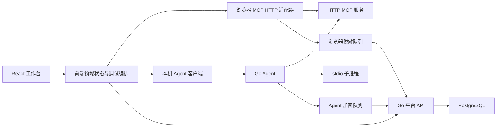

# MCP Inspector 服务版实施计划

目标目录：`/Users/wuwei/code/github/mcp-studio`，已建立 M0 合同与 M1 身份协作工程；T02 完整矩阵待验。执行状态统一维护于本目录。

日期：2026-10-13。状态：**M0 合同与 M1 T04–T09 已验证，T02 完整矩阵待验；本次不进入 M2**。当前状态见 [执行账本](progress.md)；以下保留全程规划，后续阶段仍需授权。

依据：[最终交付索引](../design-baseline-v2/design-handoff/11-final-delivery-checklist.md)、[D01–D15](../design-baseline-v2/design-handoff/08-decision-proposals.md)、[A01–A60](../design-baseline-v2/design-handoff/06-handoff-and-acceptance.md)。任务登记在 [todo.md](./todo.md)，验收分期在 [acceptance-schedule.csv](./acceptance-schedule.csv)。原仓库 `tasks/` 属于旧功能发布，不修改或覆盖。

## 1. 目标与范围

用正式前端、Go 平台和 Go 本机 Agent 实现已确认的 26 个页面 / 视图及 15 条交互链。首版内部部署，同时保留团队隔离与未来 SaaS 所需的身份边界。

范围只有服务配置、环境变量、工具调试、调用历史 / 已保存记录，以及支持这些能力的账号、项目、团队邀请、个人授权和 Agent。自动化测试产品、压测、Skills、脚本流水线、SSO、多租户商业计费和旧 SQLite 导入不随本计划加入。

“前端发起”分为用户交互编排与实际 MCP 执行：浏览器直连可访问的 HTTP；用户明确选择后 Agent 执行受限 HTTP；stdio 只能由 Agent 启动。平台不是 MCP 执行代理。仅拥有前端按钮权限不构成服务端授权。

本计划中的目录、模块名和任务划分是实施建议；不改写已确认产品规则。软件／SDK 版本和正式 API 字段已在 M0 锁定；兼容证据与尚未验证的边界见工程合同和执行账本。

## 2. 三端职责与依赖



平台 CRUD、平台 SSE 通知、浏览器与 Agent 的本机协议、MCP transport 是四种不同的接口职责，不能混成“后端统一执行”接口。

### 前端模块

| 模块 / 建议位置 | 负责 | 关键边界与页面 |
| --- | --- | --- |
| `app` / `shared/ui` | 路由、Shell、tokens、Phosphor、语言主题、基础控件、焦点 / 滚动 | P01–P26 共用；UI 控件不直接调用 MCP |
| `features/auth` | 登录、邀请身份修复、会话到期、退出提醒 | P01–P02；Cookie 平台会话不当作 MCP 凭据 |
| `features/projects` / `team` | 项目目录与切换、访问与接管、邀请、成员保护 | P03–P10；团队管理能力与项目内容能力分别呈现 |
| `features/connections` | 配置草稿、版本冲突、个人授权与连接状态 | P11–P13；配置与会话按连接 ID，不能按 URL 合并 |
| `features/environment` | 定义编辑、解析预览、来源链、应用会话、缺失修复 | P14–P16；共享定义与个人敏感值分离 |
| `features/tools` | 目录、多 Tab、定义、复杂参数、skip / touched / null / Raw | P17–P20；同工具可多草稿，不能复用无关 Run |
| `runtime/execution` | 冻结请求、执行 / 取消状态、错误归类、通道适配 | 与 UI 分离；接收明确 project / connection / tab / run 上下文 |
| `runtime/records` | 脱敏、浏览器 IndexedDB 队列、上传幂等及暂停 / 恢复 | 只持久化脱敏记录；平台离线阻止新调用，已发出可排队 |
| `features/history` / `saved` | 项目与工具范围列表、详情、修订、保存 / 恢复 | P19–P25；保存记录与 Run、上传任务分别建模 |
| `features/devices` / `workflow` | Agent 配对与状态、本人队列、7 步进度 | P05、P13、P26；进度派生，不制造完成状态 |

状态分三类：平台查询缓存、按身份键隔离的领域状态、短暂 UI 状态。项目角色不是一个跨项目全局变量；长期缓存不能保存原始参数、原始响应或 Token。生成的 API 类型不承担权限决定。

### Go 平台模块

| 模块 / 建议位置 | 负责 | 不承担的职责 |
| --- | --- | --- |
| `platform/identity` | 一次性初始化、邮箱验证 / 密码找回、密码与 Cookie 会话 | 不创建共享 MCP 服务账号 |
| `platform/access` | 团队 / 项目能力、对象授权、记录归属、Owner 接管审计 | 不因 Admin 身份开放所有项目内容 |
| `platform/projects` / `membership` | 项目、成员关系、邀请接受事务、最后维护者保护 | 不移交个人凭据 / 私有记录 |
| `platform/connections` / `environment` | 非敏感配置、定义、版本条件更新、共享规则 | 不保存个人 Token 到共享配置，不连接 MCP |
| `platform/records` | 上传接收与再脱敏、Run 历史、保存快照、显式修订、稳定分页 | 不通过重试上传重新执行工具 |
| `platform/credentials` | 显式个人备份、托管加密、重认证恢复、删除与审计 | 不将其描述成端到端加密，不供其他成员读取 |
| `platform/policy` | 容量、保留期、队列相关准入、成员移除后的封存 / 删除 | 不用前端计数替代权威校验 |
| `platform/events` / `jobs` | 已授权的 SSE 事件、到期清理、脱敏关联副本更新、邮件重试 | 不借用另一个成员的本地队列，不重放 MCP |
| `infrastructure` | PostgreSQL、邮件、密钥提供者、日志与健康检查 | 不把数据库超级用户作为业务身份 |

首版仍为模块化单体，后台作业可与平台同部署，不引入 Redis / 微服务前置依赖。模块间通过应用服务调用，禁止跨模块随意写表；记录与配置的事务边界先在合同中定义。

### Go Agent 模块

| 模块 | 负责 |
| --- | --- |
| `agent/pairing` / `agent/localapi` | 回环监听、Origin / Host 与身份校验、短期一次性配对、本机确认 |
| `agent/sessions` / `agent/mcp` | 每用户 / 项目 / 连接会话；HTTP MCP；取消与连接恢复语义 |
| `agent/process` | stdio 程序 + 参数数组、进程生命周期、首启 / 配置变更确认；不隐式 shell |
| `agent/vault` | 系统凭据库、主密钥保护；MCP 凭据、Agent 通道凭据与平台凭证不混用 |
| `agent/queue` | 本端调用冻结与脱敏、加密持久队列、限额、同任务幂等上传、断点状态查询 |
| `agent/lifecycle` | 配对解除、权限撤销、设备离线、安装 / 升级及诊断 |

一个 Run 只有一个上传责任端。浏览器从 Agent Run 创建“已保存记录”时，新保存操作属于浏览器队列，来源 Run 仍保持 Agent 执行来源。Agent 队列按记录所属项目校验上传权限，不取当前浏览器页面的角色。

## 3. 建议目录结构

建议采用单仓库管理三端和合同，Go 平台与 Agent 先共用一个 Go module、独立二进制。以下保留全程建议结构。M1 已实现的准确文件见执行账本，其余目录按后续阶段建立；`<new-root>` 对应当前独立工程目录。

```text
<new-root>/
├─ README.md
├─ go.mod / go.sum                 # 后续锁定 Go 依赖
├─ package.json                    # 后续约定前端和综合门禁入口
├─ apps/
│  └─ web/
│     ├─ src/
│     │  ├─ app/                   # 路由、providers、Shell
│     │  ├─ features/              # auth/projects/team/connections/environment/
│     │  │                         # tools/history/saved/devices/workflow
│     │  ├─ runtime/               # execution、browser MCP、Agent client、队列
│     │  ├─ shared/                # ui、tokens、i18n、身份键与纯函数
│     │  └─ generated/             # 从合同生成，不手工修补
│     ├─ public/
│     └─ tests/                    # 组件与前端集成
├─ cmd/
│  ├─ platform/                   # 平台 API 与作业进程入口
│  └─ agent/                      # 本机 Agent 入口
├─ internal/
│  ├─ platform/                   # 上表所列领域模块
│  ├─ agent/                      # 上表所列 Agent 模块
│  ├─ contracts/                  # 生成的 Go 合同适配
│  └─ infrastructure/             # DB、邮件、日志、密钥等窄接口
├─ contracts/
│  ├─ platform/                   # OpenAPI、错误与 SSE 事件
│  ├─ agent/                      # 配对、本机 API、状态和能力合同
│  ├─ schemas/                    # 配置、快照、修订与版本定义
│  └─ fixtures/                   # Go / TS 共用语义和脱敏样例，禁止真实秘密
├─ migrations/                    # 新工程自己的编号迁移，不改旧库
├─ tests/
│  ├─ integration/                # PostgreSQL、邮件、队列、权限
│  ├─ e2e/                        # 真实浏览器与完整旅程
│  ├─ fixtures/                   # 可控 HTTP / stdio / OAuth / 邮件测试端
│  └─ evidence/                   # A01–A60 对应版本与证据
├─ deploy/                        # 同站点 HTTPS、容器组合、运维说明
├─ packaging/                     # macOS / Windows 包、Linux CLI
├─ scripts/                       # 合同、验证和打包入口，后续建立
└─ docs/
   ├─ design-baseline-v2/         # 已交付规格及包校验信息
   ├─ decisions/                 # 工程细化，不重复决定产品规则
   ├─ operations/                # 邮件、密钥、备份、恢复、升级
   └─ tasks/                     # 接手后的计划及执行登记
```

前端域模块内部建议按 `api / model / ui` 分层；只有实际复用的内容进入 `shared`。Go 领域模块先保留 handler、service、repository 的窄边界，不为每个实体创建多层泛化框架。初始目录不等于全部必须一次性建好，随交付切片创建。

## 4. 开发前先落实的工程合同

M0 必须交付下列规格后才扩展实现：

1. 身份与能力：team / project / connection / user / tab / run / saved record / operation 身份语义，目录与内容能力矩阵、会话与权限版本检查。
2. 三类任务：Run 执行、记录上传、保存修订各自状态机；同操作同摘要重试、显式修订新操作身份；取消 / 超时 / 迟到结果及结果未知。
3. 环境与敏感数据：四层解析、来源标签、个人值隔离、跨语言样例；URL / 日志 / 事件 / 存储的脱敏责任。
4. API 与事件：OpenAPI、结构化错误、版本条件更新、游标分页；SSE 断线重连与重新查询权威状态；事件不携带未脱敏内容。
5. 数据与事务：邮箱与项目名称唯一性、邀请一次接受、最后维护者并发保护、记录摘要 / 修订、容量并发检查、清理与备份生命周期。
6. 本机协议：配对与凭证范围、HTTPS 页面访问回环能力、Agent 状态查询、stdio 启动确认、密钥及平台备份恢复。

前后端共用合同和测试向量，分别实现 Go / TypeScript 校验，不宣称二者直接复用同一运行时。平台能校验的是身份、允许范围和提交记录，不能承诺独立证明浏览器直连结果真实来自上游；审计显示执行来源及提交者，不新增后端代调来解决这一边界。

## 5. 开发顺序与阶段出口

采用纵向切片：每一功能连同数据、API、UI 和相关测试一起交付。Agent 可行性前置检查，但完整 Agent 不阻塞第一条浏览器 HTTP 闭环。

| 阶段 | 任务 | 交付内容 | 阶段出口与验收 |
| --- | --- | --- | --- |
| M0 规格与风险验证 | T01–T03 | 基线登记、浏览器 / Agent 可行性验证、合同与共同样例 | 调用责任和安全边界明确；冻结首批版本与兼容结果。风险未解决，不批准依赖路径 |
| M1 身份与协作基础 | T04–T09 | 工程门禁、双语主题 Shell、登录、项目、邀请与成员保护 | 真正登录后创建项目、接受邀请；不同角色与非成员访问有效阻止 |
| M2 服务到 HTTP 连接 | T10–T15 | 配置版本、环境定义 / 解析、个人会话凭据、HTTP 会话、工具目录 | 一个新项目配置变量与 HTTP 服务，成功发现工具；失败有正确修复入口 |
| M3 调试与记录闭环 | T16–T21 | 参数、执行状态、脱敏历史、已保存、修订与恢复 | 一次真实 HTTP 调用 → 上传 → 历史 → 保存 → 新 Tab 未执行；协议和业务错误分类准确 |
| M4 队列与生命周期 | T22–T24 | 浏览器脱敏持久队列、离线 / 到期 / 降级、容量与保留 | 刷新恢复队列、不重放；改角色 / 切项目不串权限；容量和删除任务可验证 |
| M5 Agent 与完整授权 | T25–T30 | 本机配对、stdio、Agent HTTP、系统凭据、OAuth / 备份、Agent 队列 | 实机运行 stdio 与 HTTP；页面关闭后已授权调用可结束；备份恢复需重认证与权限 |
| M6 全页面一致性 | T31–T33 | 状态补齐、响应式 / i18n / 主题 / 键盘、完整流程进度 | 26 页面 / 视图、15 交互链都有真实状态；A60 全链和异常链可重现 |
| M7 部署与总验收 | T34–T36 | 内部容器部署、Agent 分发、跨端回归与交付 | A01–A60 逐项有实现版本与证据，核心门禁通过，发布另行授权 |

T01–T36 是 36 个工作包，已拆为 72 个 a / b 叶子任务；每个叶子以 S–M 范围为目标，开工时补齐准确文件与必要细分。每 3 个工作包设一个检查点，共 12 个；单个叶子完成时也必须验证其验收条件，见 todo。阶段出口不是额外产品范围。团队可在合同冻结后并行处理不同责任模块；合同、迁移、权限核心与共同状态机由明确负责人统一合入，不并行争用。推荐前端、平台、Agent、验收四类责任人；同一人可兼任，不假设已经有人手或给出未经估算的工期。

## 6. 验收安排

验收清单正文仍是 [A01–A60](../design-baseline-v2/design-handoff/06-handoff-and-acceptance.md)，现有 [登记表](../design-baseline-v2/design-handoff/acceptance-register-v2.csv) 保持全部待验收。分期表将每个 A 项分配一个牵头阶段及必要联验阶段，不削减用例、不把部分通过当整项通过。

| 牵头阶段 | 验收编号 | 所需证据 |
| --- | --- | --- |
| M1 | A01–A02、A22、A24–A28、A36–A37、A55–A58 | 真实平台 API 拒绝 / 允许、并发事务、邮件验证、浏览器前后导航；涉及记录的部分在 M3 / M4 联验 |
| M2 | A03–A04、A08–A10、A43、A49–A52 | 两同 URL 连接隔离、变量解析向量、配置冲突、可控 HTTP 服务和跨域限制；Agent 部分 M5 联验 |
| M3 | A11–A21、A23、A34、A44、A46、A53–A54、A59 | Schema 向量、冻结 Run、取消竞态、真实记录接收、保存修订、恢复及跨记录脱敏 |
| M4 | A38–A40、A47–A48 | 重启 / 刷新、离线 / 过期、角色变化、限额边界、可控时钟清理；Agent / 凭据部分 M5 联验 |
| M5 | A05–A07、A41–A42 | 实机 Agent 配对 / stdio / HTTP、凭据库、OAuth 回调、备份恢复、来源伪造与令牌过期 |
| M6 | A29–A33、A35、A45、A60 | 所有适用页面状态、键盘、中文英文、亮暗主题、多窗口及连续旅程录像 / 截图 |
| M7 | A01–A60 最终签收 | 对照候选版本重跑完整门禁，补齐前期未验部分，登记已知问题与发布条件 |

### 检查层与门禁

- 每任务：相关单元 / 组件 / 合同验证；有行为变更必须加回归。前端关注焦点与滚动，平台关注授权 / 事务，Agent 关注进程和凭据边界。
- 每检查点：受影响模块测试、合同生成一致性、Go / TS 编译与构建；每个阶段至少一个真实端到端切片。
- 核心流程、认证、存储、路由、布局及生产入口变更：新目录建立等价完整 `verify` 门禁；覆盖前端 typecheck / tests / build、Go tests / vet / build、合同与跨端集成。
- 最终浏览器矩阵：Chrome / Edge 最近两个稳定大版本，M0 登记实际版本；中英 × 亮暗 × 390 / 820 / 1024 / 1440 宽，额外 1024×640 与 390×844。本机链路覆盖 macOS / Windows 安装包及 Linux CLI，不以单 OS 结果代替三者。
- 错误夹具：成功 / CORS / 401 / JSON-RPC error / tool isError / 超时 / 断连 / stdio 退出 / 上传中断 / 摘要冲突 / 邮件失败 / 凭据保存失败 / 容量满；使用确定事件和可控时钟，不靠长 sleep。
- 证据登记：任务 ID、A 编号、提交 / 构建版本、OS / 浏览器版本、测试报告、失败复现与必要截图。自动测试和人工可访问性 / 实机测试分开标注。

这些是待建立的门禁责任，不是现在可运行的新工程脚本。现有 209 项原型模型检查只可帮助提取行为样例，不能抵扣正式验收。

## 7. 主要风险与处理时机

| 风险 | 处理安排 | 不得采用的规避 |
| --- | --- | --- |
| HTTPS 浏览器访问 localhost / Agent 能力受限 | T02 先做各目标环境可行性试验；登记限制与手动切换路径 | 静默平台代理、关闭浏览器安全机制 |
| OAuth 服务能力和 transport 不一致 | M0 锁定兼容矩阵，T13 / T28 用受控授权端验证 PKCE / 回调 / 资源绑定 | 跨连接复用 Token、客户端秘密放浏览器 |
| 重试与保存修订混淆 | T03 定义操作 / 摘要 / 版本语义，T20 / T22 验证 | 同 ID 不同内容静默覆盖、上传失败重放 Tool |
| 权限撤销与后台上传竞态 | M1 统一能力，M4 / M5 在权威请求时复核并按所属项目隔离 | 使用当前页面角色、信任前端下拉或长效缓存 |
| Go / TS 解析与脱敏语义不一致 | 共同 fixtures，跨端语义对照，接收端复核 | 用 JSONB 声称保真、原始内容进入日志 / IndexedDB |
| Agent 凭据、进程和更新分发风险 | M0 可行性，M5 实机验证，M7 签名 / 安装 / 升级检查 | 隐式 shell、监听公网、继承全部敏感环境 |
| 生命周期删除与备份残留 | T24 / T29 / T34 覆盖封存、在线删除与最长 30 天备份淘汰 | 声称平台能擦除用户电脑副本 |

## 8. 开工前输入与交付物

未来开始开发前需要指定新目录绝对路径；登记目标内部域名、HTTPS / 邮件测试环境、可用 OS 测试设备，以及工程依赖 / 密钥与安装签名方案。若缺少真实测试环境，可先用明确隔离的测试端推进不依赖部分，相应验收保持待验，不能用模拟成功补签。

不在计划阶段要求提交真实 Token、密码或生产密钥，也不因尚未指定新目录而创建临时产品工程。

最终工程交付应包含：可部署平台与前端、可分发 Agent、合同与迁移、运维 / 恢复说明、A01–A60 登记和证据、已知限制。发布 / 合并仍依后续授权，本轮只有本计划及任务 / 验收分期文档。
